# Especificación de Requerimientos de Software (ERS)
## Sistema de Gestión Híbrida y Fidelización para Gimnasio SOMA (SGS)

**Proyecto:** Sistema de Gestión Gimnasio SOMA  
**Materia:** Prácticas Profesionalizantes III  
**Profesores:** Gustavo Gómez; Silvia Rocchi  
**Integrantes:** Bugnoni Agustín; Zárate Lorenzo  
**Año:** 2026  

---

## Tabla de Contenido

1. **Introducción**
   - 1.1 Propósito
   - 1.2 Alcance
   - 1.3 Definiciones, Acrónimos y Abreviaciones
2. **Descripción de Stakeholders y Usuarios**
   - 2.1 Resumen de Stakeholders
   - 2.2 Resumen de Usuarios
   - 2.3 Entorno de Usuario
   - 2.4 Perfil de los Stakeholders
   - 2.5 Representante del Área Técnica y Sistemas de Información
3. **Descripción Global del Producto**
   - 3.1 Perspectiva del Producto
   - 3.2 Resumen de Características
   - 3.3 Suposiciones y Dependencias
4. **Restricciones**
5. **Otros Requisitos del Producto**
   - 5.1 Estándares Aplicables
   - 5.2 Requisitos de Sistema (Requerimientos Funcionales y No Funcionales)
   - 5.3 Requisitos de Desempeño
   - 5.4 Requisitos de Entorno
6. **Especificaciones de Casos de Uso**
   - 6.1 Especificación de Casos de Uso Operativos (`CU001` a `CU010`)
   - 6.2 Arquitectura Base y Seguridad (`CU011` a `CU012`)
7. **Especificaciones Adicionales y Mejoras a Futuro (Roadmap v2.0)**
8. **Mapa de Navegación**
9. **Prototipos e Interfaces de Usuario**
10. **Diagrama de Clases Global del Sistema**
    - 10.1 Capa de Presentación / Rutas API (Controllers)
    - 10.2 Capa de Negocio y Acceso a Datos (DAL / CRUD)
    - 10.3 Capa de Entidades de Dominio (Modelos ORM)
11. **Diagrama de Componentes**
12. **DER Global del Sistema**
    - 12.1 DER – Subsistema de Socios, Membresías y Pagos
    - 12.2 DER – Subsistema de Asistencias, Usuarios, Moderación y Noticias
    - 12.3 DER – Subsistema de Rutinas, Plantillas y Catálogo de Ejercicios
    - 12.4 DER – Subsistema de Evolución Física y Módulos Proyectados (Turnos y Clases)
13. **Diagrama de Despliegue**
14. **Especificación de Casos de Prueba**

---

# 1. Introducción

En este documento de Especificación de Requerimientos de Software (ERS) se desarrolla el **Sistema de Gestión Híbrida y Fidelización del Gimnasio SOMA (SGS)**.

Este escrito constituye la pieza documental central para el diseño, construcción y validación del software, elaborada a partir de entrevistas de relevamiento con el propietario del gimnasio (Ricardo) y el personal operativo (recepcionistas y entrenadores). Su objetivo primordial es definir de manera concisa, trazable y verificable todas las funciones, reglas de negocio y restricciones que el sistema cumple en su versión productiva, así como su proyección evolutiva.

Esta especificación se ha elaborado siguiendo los lineamientos del estándar **"IEEE Recommended Practice for Software Requirements Specifications (ANSI/IEEE Std 830-1998)"**.

## 1.1 Propósito

El sistema desarrollado apunta a digitalizar y centralizar la gestión administrativa, deportiva y de fidelización de socios del **Gimnasio SOMA**. A este software lo denominaremos **SGS (Sistema de Gestión SOMA)**.

Dicho sistema da soporte integral al ciclo de vida del socio: alta con validación estricta de identidad (DNI), control de vigencia de cuotas acumulativas multimes, control de apto médico, terminal de autogestión de ingreso (Check-in en Tablet), detección temprana de ausentismo (+15 días sin asistir), planificación de rutinas de entrenamiento de hasta 7 días con plantillas prediseñadas, seguimiento gráfico de evolución física y progresión histórica de cargas con cálculo de Récord Personal (PR), moderación de fotos de perfil y muro institucional de noticias.

SGS aporta un beneficio directo a la organización al eliminar planillas dispersas, agilizar el paso por recepción en horas pico y brindar herramientas proactivas de retención de clientes sin reemplazar el trato humano y personalizado que distingue al gimnasio.

## 1.2 Alcance

SGS cubre en su **Fase 1 (Versión 1.1 Operativa)**:
- **Administración y Recepción:** ABM de socios con borrado lógico (`activo = False`) y re-alta inmediata con preservación de historial, registro de cobros y membresías con acumulación automática de meses de vigencia, alta y consulta de personal, moderación de fotografías de perfil y monitoreo de asistencias e inactividad.
- **Terminal de Check-in Digital (Tablet):** Interfaz táctil de ingreso por DNI que registra la asistencia en tiempo real e informa visualmente el estado de cuota (*Al día, Por vencer, Vencida*) y la vigencia del apto médico.
- **Gestión Deportiva (Entrenadores):** Diseño y edición de rutinas en formato planilla (hasta 7 días semanales con nombres personalizados), catálogo de 4 plantillas prediseñadas por objetivo con aplicación en un clic, auto-asignación de rutina de iniciación a nuevos socios, registro de mediciones antropométricas (peso y porcentaje de grasa corporal) y visualización de gráficos interactivos de progresión mensual de cargas con PR móvil de los últimos 3 meses.
- **Portal de Autogestión del Socio:** Acceso web responsive donde el cliente consulta el estado y fecha de vencimiento de su cuota, su rutina semanal detallada, su curva anual de progreso deportivo por ejercicio, su evolución física, las noticias del gimnasio y solicita el cambio de su foto de perfil.

**Delimitación de Alcance (Fuera de Fase 1 / Proyectado a Fase 2):**
- SGS no acciona barreras físicas (molinetes o cerraduras electromagnéticas), manteniendo la premisa institucional de ingreso no intrusivo.
- SGS no procesa cobros automáticos mediante pasarelas bancarias externas; la imputación de pagos es registrada por el personal de recepción o administración.
- Los módulos complementarios de *Contabilidad de Egresos / Estado de Resultados*, *Agenda de Turnos Nutricionales* y *Reserva de Clases Grupales con Cupo* cuentan ya con sus tablas relacionales preparadas en el esquema de base de datos (`GimnasioDB`) y se documentan en la **Sección 7 (Mejoras a Futuro)** para su activación en la Fase 2.

## 1.3 Definiciones, Acrónimos y Abreviaciones

### 1.3.1 Definiciones
- **Gimnasio SOMA:** Centro de entrenamiento físico y salud integral destinatario del sistema.
- **Socio / Cliente:** Persona física inscripta en el gimnasio, identificada unívocamente por su número de Documento Nacional de Identidad (DNI de 7 u 8 dígitos numéricos).
- **Apto Médico:** Certificado de salud obligatorio con vigencia anual que habilita al socio a realizar actividad física.
- **Borrado Lógico (Soft Delete):** Baja administrativa de un socio o usuario mediante el indicador `activo = False`, ocultándolo de los listados activos pero preservando intactos sus pagos, rutinas, asistencias y mediciones históricas.
- **Check-in Digital:** Registro electrónico de asistencia realizado por el socio en la tablet de recepción o por el personal administrativo al ingresar al establecimiento.
- **Plantilla de Rutina:** Esquema de entrenamiento prediseñado y desacoplado de un cliente específico, utilizado como base por los profesores para asignar planes según objetivo y nivel.
- **Récord Personal (PR 3M):** Mayor carga registrada por un socio en un ejercicio específico dentro de la ventana móvil de los últimos tres meses con actividad.

### 1.3.2 Acrónimos
- **ERS:** Especificación de Requerimientos de Software.
- **SGS:** Sistema de Gestión SOMA.
- **SPA:** Single Page Application (Aplicación de Página Única).
- **API:** Application Programming Interface (Interfaz de Programación de Aplicaciones).
- **JWT:** JSON Web Token (Estándar de token firmado para autenticación sin estado).
- **OTP:** One-Time Password (Código temporal de un solo uso para recuperación de contraseña).
- **ORM:** Object-Relational Mapping (Mapeo Objeto-Relacional provisto por SQLAlchemy).
- **DER:** Diagrama Entidad-Relación.

### 1.3.3 Abreviaciones
- **ABM / CRUD:** Alta, Baja y Modificación (Create, Read, Update, Delete).
- **DNI:** Documento Nacional de Identidad.
- **PR:** Personal Record (Récord Personal de carga levantada).
- **RBAC:** Role-Based Access Control (Control de Acceso Basado en Roles).
- **BLL:** Business Logic Layer (Capa de Lógica de Negocio).
- **DAL:** Data Access Layer (Capa de Acceso a Datos).

### 1.3.4 Referencias
- *IEEE Recommended Practice for Software Requirements Specifications (ANSI/IEEE Std 830-1998)*.
- Documentación de cátedra de *Prácticas Profesionalizantes III* (2026).

---

# 2. Descripción de Stakeholders y Usuarios

En el desarrollo de sistemas se denomina *Stakeholders* a todas aquellas personas o roles interesados o involucrados en la problemática que el software resuelve. A continuación se exponen jerárquicamente los interesados y usuarios finales del proyecto SOMA.

## 2.1 Resumen de Stakeholders

| Nombre | Descripción | Responsabilidad |
| :--- | :--- | :--- |
| **Ricardo** | Propietario y Gerente General del Gimnasio SOMA. | Define la visión del negocio, aprueba el alcance funcional del sistema, supervisa la recaudación de cuotas, las políticas de fidelización y el control del personal. |
| **Gustavo Gómez / Silvia Rocchi** | Profesores de Prácticas Profesionalizantes III. | Evalúan la calidad metodológica, arquitectónica, documental y funcional del proyecto académico-profesional. |
| **Bugnoni Agustín / Zárate Lorenzo** | Equipo de Ingeniería y Desarrollo de Software. | Relevamiento, diseño de base de datos, construcción full-stack (FastAPI + MySQL + JS ES6), aseguramiento de calidad automatizado (`pytest`) y documentación técnica. |

## 2.2 Resumen de Usuarios

| Rol en el Sistema | Descripción | Usuario de Referencia | Categoría de Stakeholder |
| :--- | :--- | :--- | :--- |
| **Admin** | Acceso total al sistema: gestión de socios, pagos, personal, baja/reactivación, rutinas, evolución, noticias y asistencias. | `cadmin` (Carlos Admin) | Gerencial / Administrativo |
| **Recepcionista** | Gestión operativa de recepción: alta y edición de socios, cobro de cuotas, consulta/alta de personal, moderación de fotos y control de check-in e inactividad. | `alopez` (Ana López) | Administrativo / Operativo |
| **Entrenador** | Gestión deportiva en salón: asignación y edición de rutinas de hasta 7 días, uso de plantillas, registro de evolución física, análisis de gráficos de progreso y publicación de noticias. | `mfuerte` (Marcos Fuerte) / `lfit` (Lucía Fit) | Deportivo / Operativo |
| **Cliente (Socio)** | Autogestión en portal personal e ingreso en tablet: consulta de cuota, rutina, gráficos de progreso con PR, evolución física, muro de noticias y check-in por DNI. | `37016902` (Agustin Bugnoni) | Usuario Final |

## 2.3 Entorno de Usuario

Los usuarios operan el sistema a través de un navegador web moderno (Google Chrome, Mozilla Firefox, Microsoft Edge o Safari) conectado a la red local o servidor donde se ejecuta el backend FastAPI:
- **Puesto de Recepción y Administración:** PC de escritorio o notebook (Windows 10/11 o Linux) con resolución estándar HD/Full HD, utilizando los paneles `admin.html` y `checkin.html`.
- **Terminal de Entrada (Tablet Check-in):** Tablet táctil ubicada en el mostrador de ingreso ejecutando la vista dedicada `/checkin` con botonera numérica de gran tamaño y retorno automático a espera tras cada lectura.
- **Salón de Musculación (Profesores):** PC de salón o tablet mediante el panel `entrenador.html`.
- **Socios:** Teléfonos móviles inteligentes (Android / iOS) o computadoras personales accediendo al portal responsive `cliente.html`.

## 2.4 Perfil de los Stakeholders

### Propietario / Gerente General (Ricardo)

| Atributo | Detalle |
| :--- | :--- |
| **Representante** | Ricardo (Propietario de Gimnasio SOMA). |
| **Descripción** | Responsable máximo de la administración comercial, operativa y de la identidad institucional del gimnasio. |
| **Tipo** | Usuario Clave / Sponsor del Proyecto. |
| **Responsabilidad** | Validar que las reglas de negocio reflejen la operatoria real del gimnasio (cobros acumulativos, control de apto médico, seguimiento de ausentes a los 15 días y preservación del trato cálido). |
| **Criterio de éxito** | Disminución de tiempos de espera en recepción, trazabilidad total de cobros de cuotas y detección temprana de socios en riesgo de abandono. |
| **Grado de participación** | Alta. |
| **Comentarios** | Cualquier modificación de alcance o regla de negocio respecto a permisos de recepción y entrenadores cuenta con su validación expresa. |

### Encargado de Recepción

| Atributo | Detalle |
| :--- | :--- |
| **Representante** | Personal de mostrador y atención al socio (`Recepcionista`). |
| **Descripción** | Primer punto de contacto con el socio al ingresar o inscribirse en el gimnasio. |
| **Tipo** | Usuario Operativo Primario. |
| **Responsabilidad** | Dar de alta nuevos socios con su pago inicial, cobrar renovaciones o adelantos de cuota, verificar alertas de ingreso en pantalla, moderar fotos de perfil y contactar por WhatsApp a los socios inactivos (+15 días). |
| **Criterio de éxito** | Registrar un alta o un pago en menos de 1 minuto y visualizar alertas de cuota/apto al instante sin acceder a datos clínicos o deportivos privados. |
| **Grado de participación** | Alta. |
| **Comentarios** | Por privacidad y separación de funciones, este perfil no visualiza ni edita rutinas ni evoluciones físicas/deportivas. |

### Cuerpo de Profesores / Entrenadores

| Atributo | Detalle |
| :--- | :--- |
| **Representante** | Profesores de salón de musculación (`Entrenador`). |
| **Descripción** | Profesionales encargados de la planificación de rutinas, seguimiento de cargas y mediciones antropométricas. |
| **Tipo** | Usuario Operativo Deportivo. |
| **Responsabilidad** | Confeccionar planes de entrenamiento personalizados de 1 a 7 días, aplicar plantillas base según objetivo, actualizar pesos de referencia mes a mes y evaluar la curva de progreso deportivo y físico del socio. |
| **Criterio de éxito** | Asignar una rutina base en segundos mediante plantillas y consultar gráficamente la evolución anual y el PR del alumno desde cualquier dispositivo. |
| **Grado de participación** | Media-Alta. |
| **Comentarios** | No tienen acceso al módulo de cobros ni a la administración de usuarios del sistema. |

## 2.5 Representante del Área Técnica y Sistemas de Información

| Atributo | Detalle |
| :--- | :--- |
| **Representante** | Bugnoni Agustín y Zárate Lorenzo. |
| **Descripción** | Analistas y Desarrolladores del Sistema SGS. |
| **Tipo** | Equipo Técnico. |
| **Responsabilidad** | Diseño arquitectónico, mantenimiento del servidor FastAPI y base de datos MySQL (`GimnasioDB`), automatización de despliegue mediante `Makefile` y ejecución de la suite de pruebas de regresión. |
| **Criterio de éxito** | Cumplimiento del 100% de las pruebas de integración automatizadas (`35/35 passed`) y despliegue reproducible en un comando (`make install && make db && make run`). |
| **Grado de participación** | Alta. |

---

# 3. Descripción Global del Producto

SGS es una plataforma web integral bajo arquitectura cliente-servidor que unifica en un solo ecosistema los cuatro portales de trabajo del gimnasio: **Portal Administrador**, **Portal Recepcionista**, **Portal Entrenador**, **Portal Socio** y **Terminal de Check-in en Tablet**.

El sistema reemplaza las anotaciones manuales dispersas por una base de datos relacional normalizada (`GimnasioDB`), garantizando que cada acción (como el pago de una cuota en recepción o la actualización de una rutina en el salón) impacte instantáneamente en la terminal de ingreso y en el celular del socio.

## 3.1 Perspectiva del Producto

El producto es un sistema autónomo diseñado específicamente para el **Gimnasio SOMA**. Su arquitectura desacopla una **API RESTful en Python (FastAPI + SQLAlchemy + Pydantic v2)** de un **Frontend SPA modular en JavaScript ES6**, respaldados por **MySQL 8.0+**. Esta disposición permite que múltiples terminales (PC de recepción, tablet de ingreso, dispositivos de entrenadores y smartphones de socios) operen simultáneamente contra el mismo repositorio central con control estricto de concurrencia y permisos por rol (RBAC).

## 3.2 Resumen de Características

| Característica | Beneficio para el Cliente (Gimnasio SOMA) |
| :--- | :--- |
| **Gestión de Socios e Identidad Única por DNI** | Administración centralizada de fichas personales, validación estricta de DNI (7-8 dígitos), control de apto médico, borrado lógico (`activo = False`) y re-alta inmediata sin pérdida de historial. |
| **Gestión de Pagos y Vigencia Acumulativa Multimes** | Registro de cobros iniciales y renovaciones por múltiples medios de pago. Acumulación inteligente de meses sobre la fecha de vencimiento vigente si el socio está al día, o desde la fecha actual si estaba vencido. |
| **Check-in Digital y Alertas de Inactividad (+15 días)** | Autogestión de ingreso en tablet por DNI con semáforo visual de cuota y apto médico. Detección automática de socios ausentes por más de 15 días con acceso directo a contacto por WhatsApp para fidelización. |
| **Planificador de Rutinas Multi-día y Plantillas** | Editor en formato planilla de hasta 7 días con nombres personalizados por jornada. Catálogo de 4 plantillas prediseñadas (Iniciación, Pérdida de Peso, Hipertrofia, Fuerza) y asignación automática de rutina de iniciación a nuevos socios. |
| **Analítica de Progreso Deportivo (PR 3M) y Evolución Física** | Guardado automático de cierres mensuales de rutina, gráficos interactivos anuales con paginación por año calendario, cálculo de Récord Personal (PR) en ventana móvil de 3 meses y seguimiento antropométrico (peso y `%` grasa). |
| **Comunicación y Fidelización (Muro de Noticias y Perfil)** | Publicación de comunicados con soporte de imagen, depuración automática a los 60 días y opción de fijar noticias **permanentes**. Flujo de solicitud y moderación de foto de perfil del socio por parte del staff. |
| **Seguridad, Roles y Recuperación Autónoma** | Autenticación mediante tokens JWT firmados (`HS256`), contraseñas cifradas con `PBKDF2-SHA256`, cambio obligatorio de clave en primer ingreso, recuperación por código OTP de 6 dígitos y segregación de vistas por rol. |

## 3.3 Suposiciones y Dependencias

### 3.3.1 Suposiciones
- Se asume que el establecimiento cuenta con al menos una computadora en recepción/administración y una tablet o pantalla secundaria conectada a la misma red local para el Check-in de socios.
- Se asume que el DNI de cada socio es verificado por el recepcionista al momento de realizar el alta inicial.

### 3.3.2 Dependencias
- **Motor de Base de Datos:** Requiere un servidor MySQL 8.0+ (o MariaDB equivalente) activo en el puerto configurado en `DATABASE_URL`.
- **Entorno de Ejecución:** Requiere Python 3.10+ con los paquetes especificados en `backend/requirements.txt` (`FastAPI`, `Uvicorn`, `SQLAlchemy`, `PyMySQL`, `Pydantic`, `PyJWT`, `Cryptography`, `python-dateutil`).
- **Servicio SMTP (Opcional):** El envío de correos reales para el código OTP de recuperación de contraseña utiliza la configuración SMTP del archivo `.env`, contando con modo simulación en consola local para entornos sin salida de correo.

---

# 4. Restricciones

1. **Restricciones de Hardware y Red:** El sistema debe operar de manera fluida en equipos estándar de oficina y tablets de gama media a través de navegadores web sin requerir instalación de software propietario en los dispositivos clientes.
2. **Restricciones Operativas (No Intrusividad):** Por definición expresa de la gerencia, el Check-in Digital no debe bloquear físicamente el paso mediante molinetes; su función es informar de manera amigable al socio y alertar en pantalla al recepcionista.
3. **Restricciones de Integridad Referencial y Contable:** Ningún socio con historial de pagos o rutinas debe eliminarse físicamente durante la operatoria normal; toda baja se instrumenta mediante borrado lógico (`activo = False`) para no alterar los cierres de caja históricos.
4. **Restricciones de Privacidad por Rol:** El rol **Recepcionista** tiene vedado el acceso a las pestañas de *Rutina Asignada*, *Evolución Física*, *Cargas Deportivas* y edición de rutinas, limitándose a la ficha general y gestión de cobros. Asimismo, el rol **Entrenador** no tiene acceso a la gestión de pagos ni a la administración de usuarios del personal.

---

# 5. Otros Requisitos del Producto

## 5.1 Estándares Aplicables

- **Arquitectura API:** RESTful sobre protocolo HTTP/1.1 con intercambio de payloads en formato JSON (RFC 8259) y documentación automática bajo especificación **OpenAPI 3.1.0 (Swagger UI)**.
- **Autenticación y Seguridad:** JSON Web Tokens (**RFC 7519**) con algoritmo `HS256` y derivación criptográfica de contraseñas **PBKDF2-HMAC-SHA256** (200.000 iteraciones, NIST SP 800-132).
- **Codificación de Base de Datos:** Estándar Unicode `utf8mb4` con colación `utf8mb4_unicode_ci` sobre motor transaccional `InnoDB`.

## 5.2 Requisitos de Sistema

### 5.2.1 Requerimientos Funcionales (Mapa General de Paquetes)

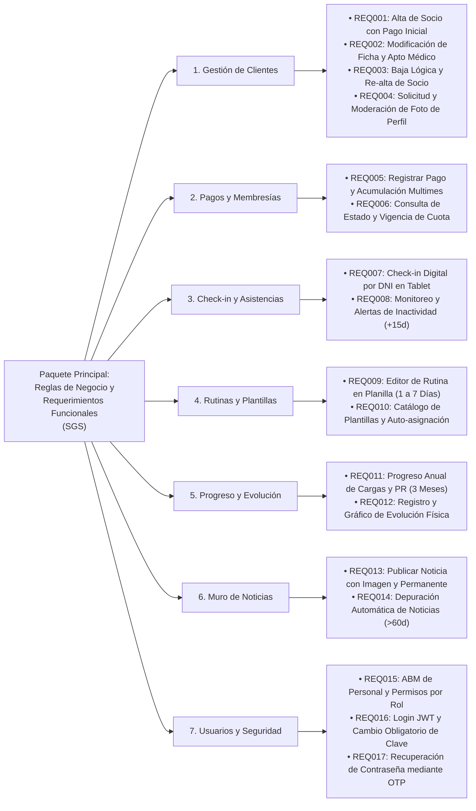

---

### 5.2.2 Requerimientos para la Gestión de Clientes

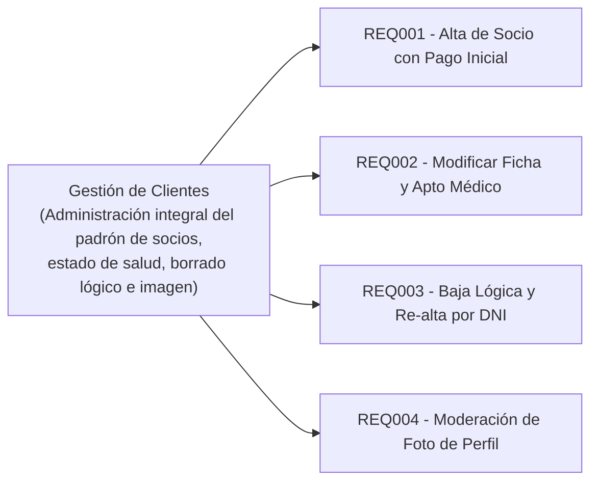

- **Descripción gestión de clientes:** El sistema cuenta con un administrador de socios accesible para los roles `Admin`, `Recepcionista` y `Entrenador` (este último con permisos acotados al ámbito deportivo), garantizando la unicidad del DNI entre las tablas `Cliente` y `Usuario`.
- **`REQ001` – Alta de Socio con Pago Inicial:** Permite registrar un nuevo socio exigiendo DNI numérico de 7 u 8 dígitos (`^\d{7,8}$`), Nombre, Apellido, Edad, Email, Teléfono, Dirección, estado de Apto Médico y los datos obligatorios de su `primer_pago` (monto, método de pago y meses abonados). El sistema crea automáticamente su credencial en `Usuario` con `usuario_login = dni`, contraseña inicial por defecto `clave1234`, `rol = 'Cliente'`, `debe_cambiar_password = True` y le asigna por defecto la plantilla de rutina de *Iniciación y Acondicionamiento*.
- **`REQ002` – Modificación de Ficha y Apto Médico:** Permite actualizar los datos personales, domicilio y vigencia del certificado de apto médico (`apto_medico_vigente` y `fecha_vencimiento_apto`).
- **`REQ003` – Baja Lógica y Re-alta de Socio:** Al dar de baja un socio, el sistema marca `Cliente.activo = False` y `Usuario.activo = False` preservando todo su historial. Si se vuelve a dar de alta un DNI que se encontraba inactivo, el sistema reactiva su ficha existente (`activo = True`), actualiza sus datos y registra el nuevo pago sin provocar colisiones de clave primaria.
- **`REQ004` – Solicitud y Moderación de Foto de Perfil:** El socio puede subir una fotografía desde su portal, generando un registro en `Solicitud_Foto_Perfil` con estado `'Pendiente'`. El personal (`Admin` o `Recepcionista`) visualiza las solicitudes pendientes y las aprueba (impactando en `Cliente.foto_url`) o las rechaza indicando un motivo.

---

### 5.2.3 Requerimientos para la Gestión de Pagos y Membresías

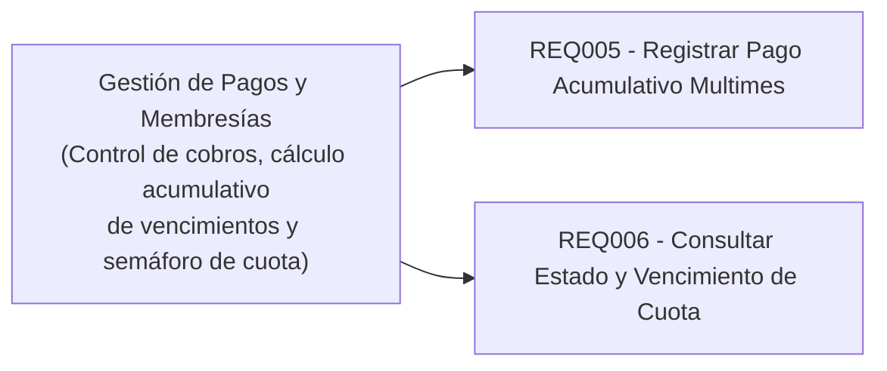

- **Descripción gestión de pagos:** Permite imputar pagos de cuotas y calcular de forma exacta la fecha de vencimiento de cada socio.
- **`REQ005` – Registrar Pago y Acumulación Multimes:** Al registrar un pago indicando `meses_abonados` (1 a 12 meses), el sistema verifica si el socio posee una cuota vigente (`fecha_vencimiento_cuota >= hoy`). Si está al día, suma los nuevos meses sobre la fecha de vencimiento futura; si estaba vencido, calcula el nuevo vencimiento a partir de la fecha del pago actual. Actualiza en la misma transacción `Cliente_Membresia`.
- **`REQ006` – Consulta de Estado y Vigencia de Cuota:** Calcula dinámicamente el estado de cuota del socio clasificándolo en `'Al día'` (más de 5 días de vigencia restante), `'Por vencer'` (entre 0 y 5 días restantes) o `'Vencida'` (fecha de vencimiento superada), exponiéndolo en el listado de clientes, en el check-in y en el portal del socio.

---

### 5.2.4 Requerimientos para el Check-in Digital y Asistencias

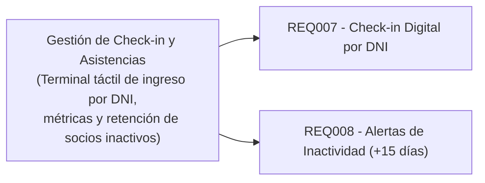

- **Descripción gestión de asistencias:** Registra el flujo diario de concurrencia al gimnasio y alimenta las alertas de retención.
- **`REQ007` – Check-in Digital por DNI:** El socio ingresa su DNI en la interfaz táctil (`/checkin`). El sistema valida que exista y esté activo, registra la asistencia en la tabla `Asistencia` guardando una instantánea del estado de su cuota y apto médico, y despliega una tarjeta de bienvenida (verde si todo está en regla, o con alertas destacadas si tiene cuota vencida o apto médico caduco).
- **`REQ008` – Monitoreo de Asistencias y Alertas de Inactividad (+15 días):** Provee al panel de Administración y Recepción indicadores en tiempo real (*Ingresos de Hoy, Últimos 7 días, Últimos 30 días*), el listado cronológico de ingresos del día y una tabla específica de **Socios Activos con más de 15 días sin asistir**, incluyendo un botón de contacto directo vía WhatsApp.

---

### 5.2.5 Requerimientos para la Gestión de Rutinas y Plantillas

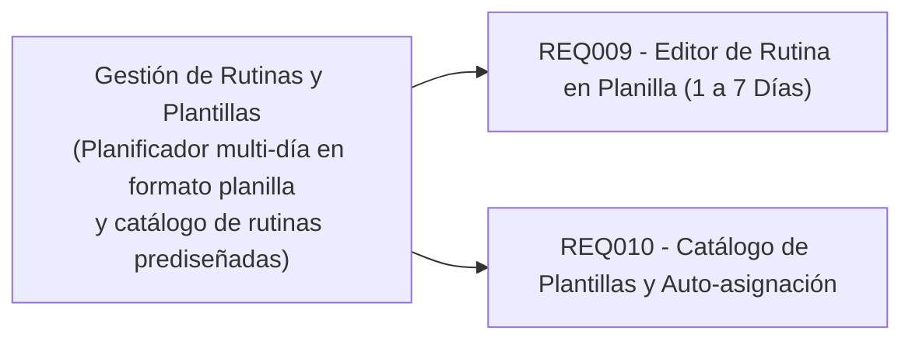

- **Descripción gestión de rutinas:** Permite a los entrenadores y administradores estructurar el entrenamiento semanal de cada socio.
- **`REQ009` – Crear y Editar Rutina en Planilla (1 a 7 Días):** Interfaz de pestañas por día (`Día 1` a `Día 7`) donde el profesor define un título opcional para cada jornada (`nombre_dia`, ej. *"Torso Fuerza"*), selecciona ejercicios del catálogo e ingresa series, repeticiones, carga en kg y tiempo de descanso.
- **`REQ010` – Aplicar Plantilla Prediseñada y Auto-asignación:** El sistema dispone de las tablas `Plantilla_Rutina` y `Detalle_Plantilla_Rutina` con 4 planes base (*Iniciación, Pérdida de Peso, Hipertrofia, Fuerza*). El entrenador puede aplicar cualquier plantilla a un socio en un clic y luego personalizarla. Además, todo socio nuevo recibe automáticamente la plantilla de *Iniciación*.

---

### 5.2.6 Requerimientos para el Progreso Deportivo y Evolución Física


- **Descripción gestión de evolución:** Permite tanto al socio (en *Mi Progreso*) como al entrenador/administrador (en *Cargas Deportivas* y *Evolución Física*) evaluar objetivamente las mejoras obtenidas.
- **`REQ011` – Visualizar Progreso Anual de Cargas y PR (3 Meses):** Cuando se actualiza una rutina en un nuevo mes, el sistema preserva el cierre mensual anterior (`activa = False`) como historial. A partir de esos cierres mensuales, grafica la curva de progresión de carga máxima por ejercicio filtrable por año calendario (`2025`, `2026`, etc.) y calcula el **Récord Personal (PR) vigente de los últimos 3 meses** para reflejar el estado de fuerza actual del socio incluso tras períodos de descarga.
- **`REQ012` – Registrar y Graficar Evolución Física Antropométrica:** Permite cargar mediciones periódicas de peso corporal (`peso_kg`), porcentaje de tejido adiposo (`porcentaje_grasa`) y observaciones, representándolas en un gráfico evolutivo de doble serie junto a su tabla histórica.

---

### 5.2.7 Requerimientos para el Muro de Noticias y Gestión de Usuarios

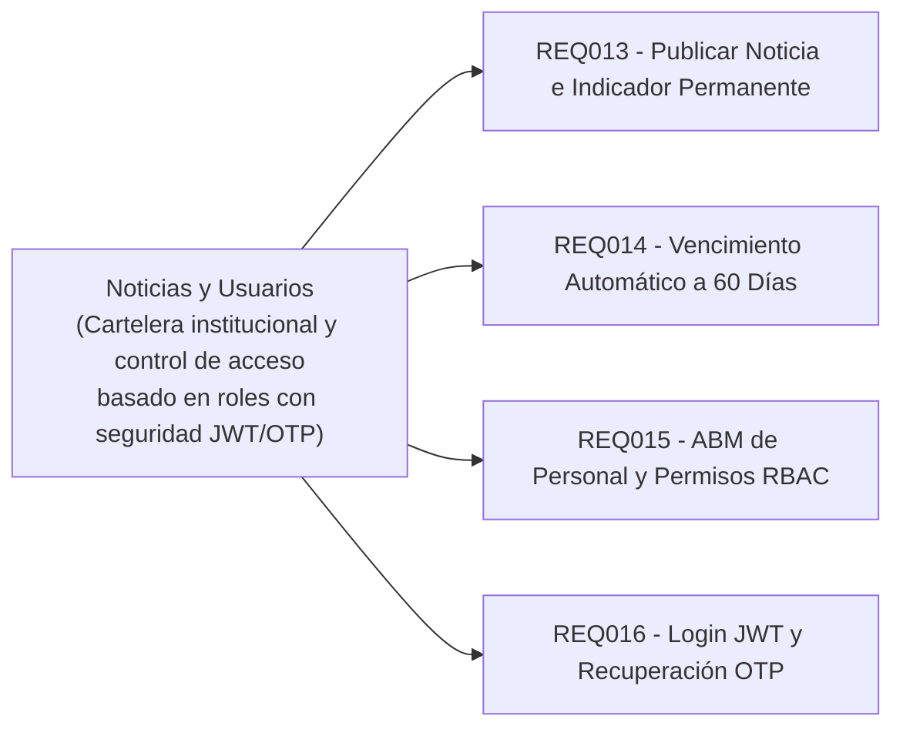

- **`REQ013` y `REQ014` – Muro de Noticias con Soporte de Imagen y Noticias Permanentes:** Permite publicar comunicados categorizados con imagen adjunta opcional. Las noticias convencionales se depuran automáticamente al cumplir 60 días de antigüedad, mientras que aquellas marcadas con el casillero **Permanente (`permanente = True`)** quedan fijadas al inicio del muro y exentas del borrado automático.
- **`REQ015` – ABM de Usuarios del Personal y Permisos por Rol:** El rol `Admin` posee control total sobre el alta, edición, baja lógica y reactivación del personal. El rol `Recepcionista` puede consultar el listado de usuarios y dar de alta nuevos integrantes del staff, pero tiene restringida la eliminación o desactivación de cuentas.
- **`REQ016` y `REQ017` – Autenticación JWT, Primer Ingreso y Recuperación por OTP:** El acceso se valida mediante tokens JWT (`HS256`). Si `debe_cambiar_password = True`, el sistema exige el cambio de clave antes de habilitar el portal. En caso de olvido, el usuario puede solicitar un código numérico OTP de 6 dígitos (con validez de 10 minutos) enviado a su correo electrónico registrado.

---

### 5.2.8 Requerimientos No Funcionales

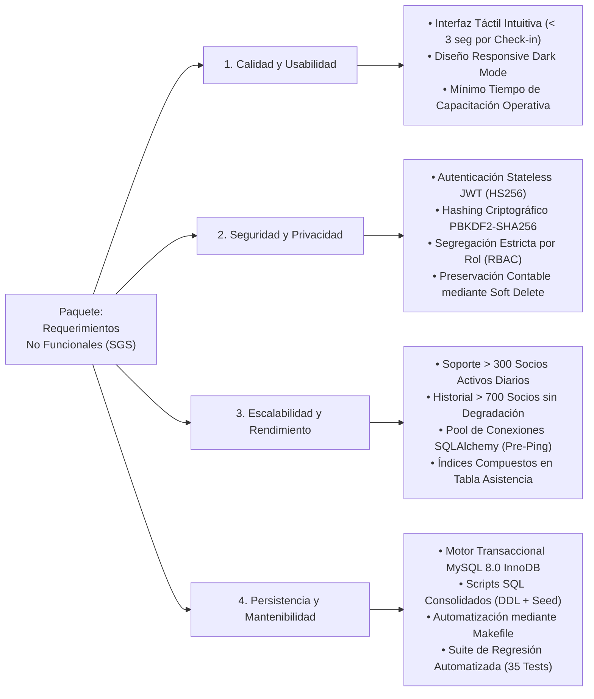

## 5.3 Requisitos de Desempeño

- **Tiempo de respuesta en Check-in:** La validación del DNI e inserción de asistencia en `/api/asistencias/checkin` se ejecuta en menos de **200 ms** gracias al índice compuesto `idx_asistencia_dni_fecha (dni_cliente, fecha_hora)`, garantizando una experiencia total menor a 3 segundos por socio en horarios pico.
- **Capacidad de Almacenamiento y Concurrencia:** El pool de conexiones de SQLAlchemy (`pool_pre_ping=True`, `pool_recycle=3600`) soporta una base superior a 300 socios activos diarios y miles de registros históricos de pagos, detalles de rutinas y asistencias sin bloqueos.

## 5.4 Requisitos de Entorno

- **Servidor:** Sistema Operativo Linux, macOS o Windows con Python 3.10+, servidor ASGI `Uvicorn` y motor relacional `MySQL 8.0+`.
- **Cliente:** Cualquier dispositivo con navegador web compatible con HTML5, CSS3 y ECMAScript 6 (ES2015+), sin necesidad de plugins adicionales.


---

# 6. Especificaciones de Casos de Uso

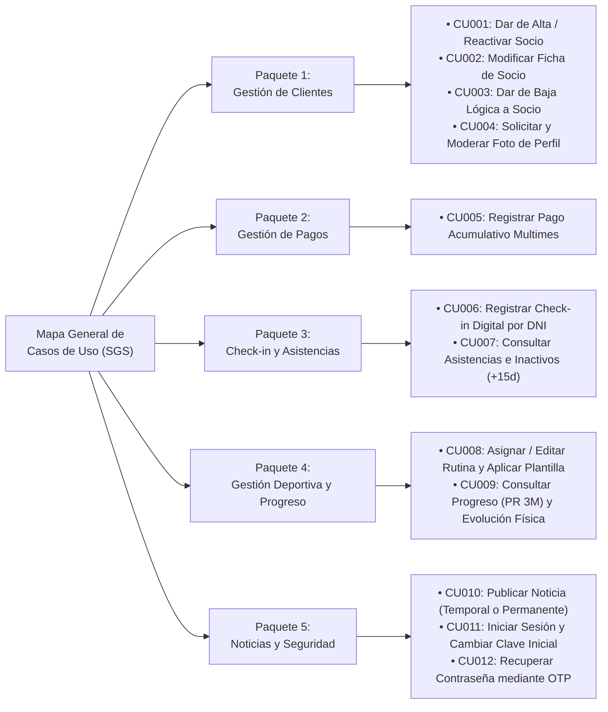

---

## 6.1 Especificación de Casos de Uso Operativos

### Diagrama de Casos de Uso – Gestión de Clientes y Pagos

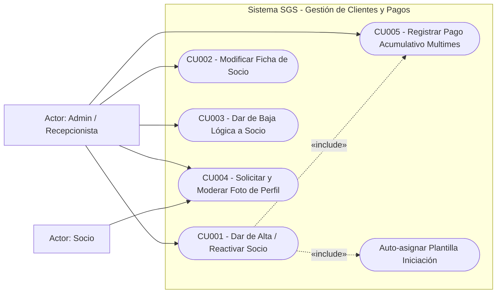

---

### `CU001` – Dar de Alta / Reactivar Socio

#### Objetivo
Permitir al personal de recepción o administración inscribir a un nuevo socio en el gimnasio (o reactivar su ficha si había sido dado de baja lógica anteriormente), exigiendo su pago inicial, creando su cuenta de usuario con DNI como login y asignándole automáticamente su rutina de iniciación.

#### Precondiciones
El usuario operador ha iniciado sesión en el sistema con rol `Admin` o `Recepcionista`.

#### Poscondiciones
1. Se persiste (o reactiva con `activo = True`) el registro en `Cliente` y `Direccion`.
2. Se crea (o reactiva) el registro en `Usuario` con `usuario_login = dni`, contraseña temporal inicial `clave1234`, `rol = 'Cliente'` y `debe_cambiar_password = True`.
3. Se registra el pago inicial en `Pago` y la vigencia activa en `Cliente_Membresia`.
4. Se asigna automáticamente la rutina inicial basada en la plantilla de *Iniciación*.

#### Eventos disparadores del caso de uso
El operador hace clic en el botón **"Nuevo Cliente"** en el módulo de Gestión de Clientes.

#### Puntos de extensión y condiciones
- `«include»` `CU005` – Registrar Pago Inicial.
- `«extend»` Reactivación automática si el DNI ingresado pertenece a un socio con `activo = False`.

#### Descripción analítica del caso de uso

| Escenario | Pasos de Ejecución |
| :--- | :--- |
| **Camino Básico (Basic Path)** | 1. El operador presiona el botón `"Nuevo Cliente"`.<br>2. El sistema despliega el formulario de alta solicitando DNI (7 u 8 dígitos), Nombre, Apellido, Edad, Email, Teléfono, Dirección, Apto Médico y los datos del Primer Pago (Monto, Método de Pago, Meses Abonados).<br>3. El operador completa los datos y presiona `"Guardar Cliente"`.<br>4. El sistema valida el formato numérico estricto del DNI (`^\d{7,8}$`) y que todos los campos obligatorios y el pago inicial estén presentes.<br>5. *Alternate 5a: El DNI pertenece a un socio inactivo (`activo = False`).*<br>6. *Exception 5b: El DNI ya pertenece a un socio activo o a un miembro del personal.*<br>7. El sistema inicia una transacción atómica: inserta la `Direccion`, el `Cliente`, el `Usuario` (`rol = 'Cliente'`), el `Pago` inicial, la `Cliente_Membresia` y la `Rutina` de iniciación.<br>8. El sistema confirma la operación y actualiza el listado de socios en pantalla. |
| **Alternativo 5a: Re-alta de Socio Inactivo** | 1. El sistema detecta que el DNI ingresado ya existe en la tabla `Cliente` con `activo = False`.<br>2. El sistema actualiza los datos personales y de dirección del socio existente, cambia `Cliente.activo = True` y `Usuario.activo = True`, registra el nuevo pago e impacta la nueva vigencia sin duplicar la clave primaria.<br>3. Continúa en el paso 8 del camino básico. |
| **Excepción 5b: DNI Duplicado Activo o Formato Inválido** | 1. El sistema detecta que el DNI no tiene 7-8 dígitos numéricos o ya se encuentra activo en el padrón.<br>2. El sistema rechaza la petición con código HTTP `400` / `422` y muestra un mensaje descriptivo al operador sin realizar cambios en la base de datos. |

#### Diagrama de Clases (`CU001` y `CU005`)

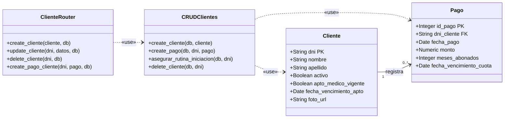

#### Diagrama de Secuencia (`CU001`)

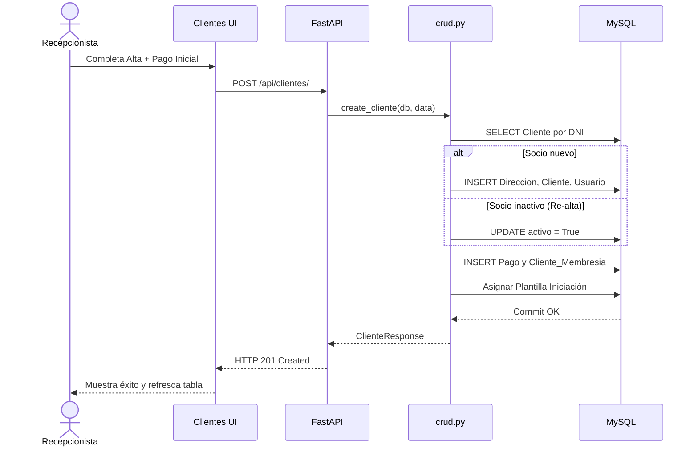

---

### `CU003` – Dar de Baja Lógica a Socio

#### Objetivo
Desactivar operativamente a un socio (`activo = False`) tanto en el padrón de clientes como en su cuenta de acceso, conservando intactos todos sus pagos, rutinas, mediciones y asistencias históricas.

#### Precondiciones
El socio existe y se encuentra activo (`activo = True`). El operador tiene rol `Admin` o `Recepcionista`.

#### Poscondiciones
`Cliente.activo` y `Usuario.activo` pasan a `False`. El socio deja de aparecer en el listado de activos y no puede iniciar sesión ni registrar check-in hasta ser reactivado.

#### Descripción analítica del caso de uso

| Escenario | Pasos de Ejecución |
| :--- | :--- |
| **Camino Básico (Basic Path)** | 1. El operador localiza al socio en la tabla y presiona el botón `"Dar de Baja"`.<br>2. El sistema solicita confirmación de la operación.<br>3. El operador confirma la acción.<br>4. El sistema ejecuta `DELETE /api/clientes/{dni}`.<br>5. El backend actualiza `Cliente.activo = False`, `Usuario.activo = False` y marca las membresías activas como `'Cancelado'`.<br>6. El sistema informa el éxito de la baja y actualiza la grilla. |
| **Alternativo: Cancelación** | 1. El operador presiona `"Cancelar"` en el cuadro de confirmación y el sistema aborta la acción sin cambios. |

---

### `CU005` – Registrar Pago Acumulativo Multimes

#### Objetivo
Imputar el cobro de uno o varios meses de cuota a un socio, acumulando la nueva vigencia sobre su fecha de vencimiento actual si se encuentra al día, o desde la fecha de pago si se encontraba vencido.

#### Precondiciones
El socio se encuentra registrado en el sistema. El operador tiene rol `Admin` o `Recepcionista`.

#### Poscondiciones
Se inserta un nuevo registro en `Pago` con `meses_abonados` y `fecha_vencimiento_cuota` calculada, y se actualiza `Cliente_Membresia` con estado `'Activa'`.

#### Descripción analítica del caso de uso

| Escenario | Pasos de Ejecución |
| :--- | :--- |
| **Camino Básico (Basic Path)** | 1. El operador abre la `"Ficha General"` del socio y se dirige a la sección `"Registrar Nuevo Pago"`.<br>2. Ingresa el monto, selecciona el método de pago, la cantidad de meses a abonar (`1` a `12`) y una descripción opcional.<br>3. El sistema consulta el último vencimiento de cuota del socio.<br>4. **Regla acumulativa:** Si el vencimiento previo es mayor o igual a hoy, suma `relativedelta(months=meses_abonados)` a dicho vencimiento; si era menor a hoy (vencido), suma los meses a partir de la fecha del pago.<br>5. El sistema guarda el registro en `Pago` y actualiza `Cliente_Membresia`.<br>6. El sistema refresca el historial de pagos y cambia el indicador del socio a `'Al día'`. |

---

### `CU006` y `CU007` – Check-in Digital en Tablet y Alertas de Inactividad (+15 Días)

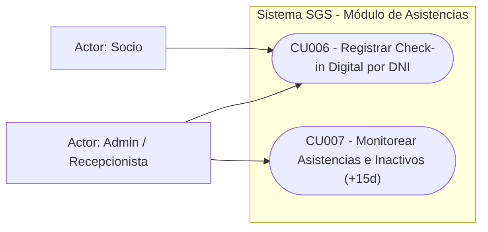

#### Objetivo (`CU006` y `CU007`)
Permitir el registro ágil de ingreso por DNI en la tablet de entrada validando cuota y apto médico en tiempo real (`CU006`), y proveer al personal administrativo el tablero de asistencias del día junto con la alerta automática de socios activos que llevan más de 15 días sin concurrir (`CU007`).

#### Descripción analítica (`CU006` – Check-in Digital)

| Escenario | Pasos de Ejecución |
| :--- | :--- |
| **Camino Básico (Basic Path)** | 1. El socio digita su DNI de 7 u 8 dígitos en el teclado táctil de `/checkin` y presiona `"INGRESAR"`.<br>2. El sistema verifica que el DNI exista en `Cliente` y posea `activo = True`.<br>3. El sistema evalúa el estado de su cuota (`Al día`, `Por vencer` o `Vencida`) y la vigencia de su apto médico (`apto_medico_vigente` y `fecha_vencimiento_apto`).<br>4. El sistema inserta el registro en la tabla `Asistencia` con fecha/hora actual.<br>5. El sistema muestra la tarjeta de bienvenida con la foto del socio, nombre, estado de cuota, estado de apto médico y total de asistencias en los últimos 30 días.<br>6. *Alternate 5a: Socio con cuota vencida o apto médico vencido.*<br>7. Tras unos segundos, la pantalla limpia el formulario automáticamente para recibir al siguiente socio. |
| **Alternativo 5a: Ingreso con Alerta de Cuota o Apto Vencido** | 1. El sistema registra igualmente la asistencia (no bloquea el paso físico), pero despliega alertas visuales amarillas/rojas indicando `"Cuota Vencida - Pasar por Recepción"` y/o `"Apto Médico Vencido o Pendiente"`. |
| **Excepción: DNI Inexistente o Socio Inactivo** | 1. Si el DNI no existe o el socio fue dado de baja (`activo = False`), el sistema rechaza el check-in con un aviso en rojo indicando consultar en recepción. |

#### Diagrama de Secuencia (`CU006` y `CU007`)

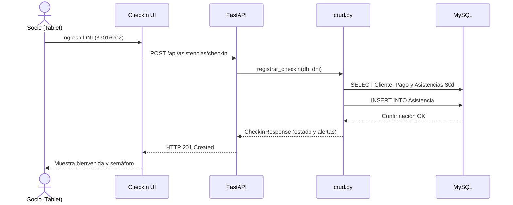

---

### `CU008` y `CU009` – Gestión de Rutinas, Plantillas y Gráficos de Progreso (PR 3M)

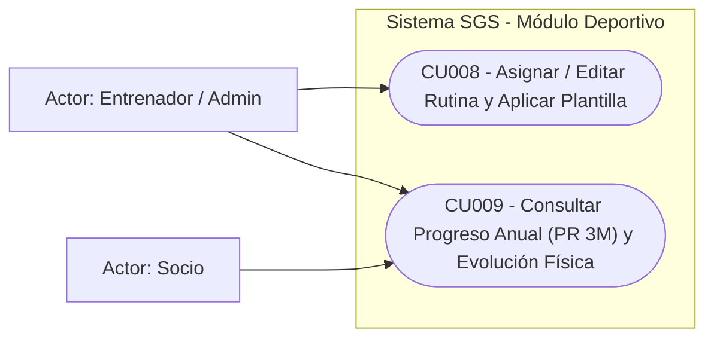

#### Objetivo (`CU008` y `CU009`)
Permitir a los entrenadores crear o editar rutinas de hasta 7 días en formato planilla o aplicar una plantilla prediseñada (`CU008`), conservando cierres mensuales automáticos para que tanto el socio (*Mi Progreso*) como el entrenador (*Cargas Deportivas*) visualicen la curva de evolución anual por ejercicio y el **Récord Personal (PR) de los últimos 3 meses** (`CU009`).

#### Descripción analítica (`CU008` y `CU009`)

| Escenario | Pasos de Ejecución |
| :--- | :--- |
| **Camino Básico (`CU008` - Edición de Rutina con Historial Mensual)** | 1. El entrenador selecciona un socio y abre el editor de rutina (o elige aplicar una de las 4 plantillas base desde el selector).<br>2. Configura objetivo, período, cantidad de días (`1` a `7`), nombres de cada día y las filas de ejercicios con series, repeticiones, carga (kg) y descanso.<br>3. Presiona `"Guardar Rutina"`.<br>4. El backend verifica si la rutina activa anterior pertenece a un mes calendario previo: si es de un mes anterior, la preserva con `activa = False` como cierre histórico mensual y crea una nueva `Rutina` activa para el mes en curso; si es del mismo mes actual, actualiza sus detalles.<br>5. El sistema confirma el guardado y actualiza la planilla del socio. |
| **Camino Básico (`CU009` - Consulta de Progreso y PR 3M)** | 1. El socio (en *Mi Progreso*) o el entrenador (en la pestaña *Cargas Deportivas* de la ficha del socio) selecciona un ejercicio del menú desplegable.<br>2. El sistema consulta todas las rutinas mensuales históricas del socio para ese ejercicio.<br>3. El sistema calcula el **PR vigente de los últimos 3 meses** (máxima carga en la ventana de los últimos 3 meses con registro) y devuelve los puntos mensuales del año seleccionado (`2026`, `2025`, etc.).<br>4. El frontend renderiza el gráfico interactivo en `Chart.js`, las tarjetas de resumen (*PR Últimos 3 Meses, Primera Carga del Año, Última Carga del Año*) y los botones de paginación por año calendario. |

#### Diagrama de Secuencia (`CU009` – Progreso de Rutinas y PR 3M)

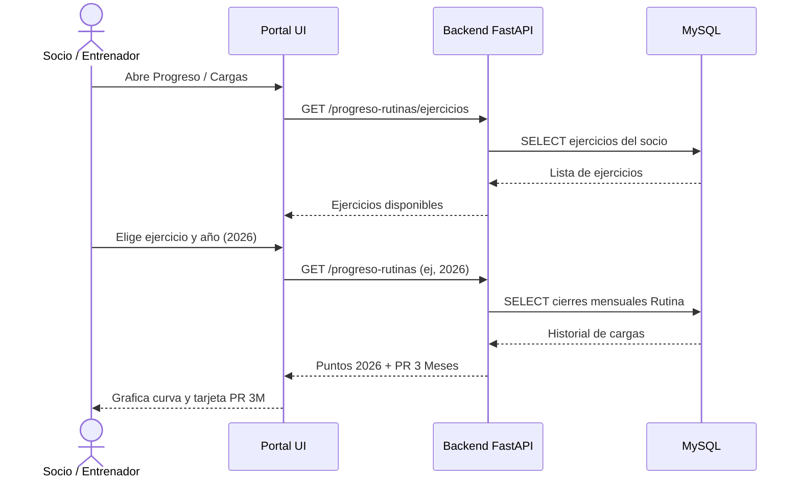

---

### `CU010` – Publicar Noticia en el Muro (Temporal o Permanente)

#### Objetivo
Permitir a Administradores y Entrenadores publicar novedades institucionales con imagen opcional, pudiendo marcarlas como **Permanentes** para evitar su borrado automático a los 60 días.

#### Descripción analítica (`CU010`)

| Escenario | Pasos de Ejecución |
| :--- | :--- |
| **Camino Básico (Basic Path)** | 1. El usuario (`Admin` o `Entrenador`) ingresa al módulo `"Muro de Noticias"` y presiona `"Nueva Noticia"`.<br>2. Completa Título, Categoría, Contenido, adjunta opcionalmente una imagen (validada en formato `JPG/PNG/WEBP` hasta 5 MB) y marca opcionalmente el casillero **"Noticia Permanente (No vence a los 60 días)"**.<br>3. Al confirmar, el sistema almacena la noticia en la tabla `Noticia`.<br>4. Cada vez que se consulta el muro (`GET /api/noticias/`), el sistema depura automáticamente las noticias con `permanente = False` cuya `fecha_publicacion` supere los 60 días y retorna primero las noticias permanentes seguidas de las más recientes. |

---

## 6.2 Arquitectura Base y Seguridad (`CU011` y `CU012`)

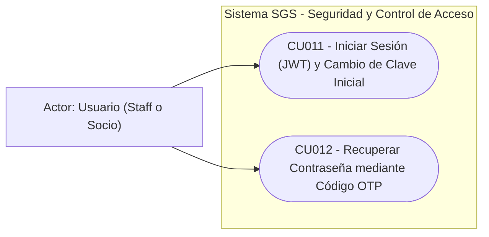

### `CU011` – Iniciar Sesión y Cambio Obligatorio de Contraseña

- **Objetivo:** Autenticar la identidad del usuario contra la tabla `Usuario`, verificar que la cuenta esté activa (`activo = True`), emitir un token firmado `JWT` con su rol y redirigirlo a su portal correspondiente (`admin.html`, `entrenador.html` o `cliente.html`).
- **Verificación Criptográfica y Retrocompatibilidad:** Soporta verificación en tiempo constante (`hmac.compare_digest`) para hashes `pbkdf2_sha256`, `SHA-256` hexadecimal de 64 caracteres y credenciales de prueba sembradas.
- **Primer Ingreso:** Si `Usuario.debe_cambiar_password == True`, el frontend bloquea la navegación y presenta el modal de cambio obligatorio de contraseña (`POST /api/auth/change-password`).

### `CU012` – Recuperación de Contraseña mediante Código OTP

- **Objetivo:** Permitir a cualquier usuario restablecer su contraseña sin intervención del administrador mediante un código numérico temporal de 6 dígitos (`OTP`).
- **Flujo Operativo:**
  1. El usuario ingresa su `usuario_login` (o DNI) en `"¿Olvidaste tu contraseña?"` (`POST /api/auth/request-otp`).
  2. El sistema localiza el email asociado, genera un OTP de 6 dígitos con expiración de 10 minutos, lo envía por correo (retornando el email enmascarado, ej. `ag***@gmail.com`).
  3. El usuario ingresa el OTP y su nueva contraseña (`POST /api/auth/verify-otp-reset`), quedando actualizada con hash `pbkdf2_sha256`.


---

# 7. Especificaciones Adicionales y Mejoras a Futuro (Roadmap v2.0)

Con el objetivo de mantener una arquitectura evolutiva y escalable, aquellos requerimientos secundarios surgidos durante el relevamiento inicial que excedían el núcleo operativo de la Fase 1 fueron modelados a nivel de base de datos y documentados en detalle en [MejorasAFuturo.md](file:///home/agustin/Practicas%20profesionalizantes%20III/2_%20Zarate,%20Bugnoni%20Agustin-20260824T221128Z-1-001/Soma/Documentos/MejorasAFuturo.md) para su activación en la **Versión 2.0**:

| ID Mejora | Módulo Proyectado | Estado en Base de Datos (`GimnasioDB`) | Descripción de la Evolución |
| :--- | :--- | :--- | :--- |
| **MF-01** | **Egresos y Estado de Resultados (`CU-10` / `RF-F3`)** | Tabla `Pago` (Ingresos) activa; se proyecta tabla `Gasto`. | Registro de costos fijos y variables (alquiler, sueldos, servicios) para calcular el balance neto mensual en el panel Admin. |
| **MF-02** | **ABM de Planes Especiales y Convenios (`CU-08` / `RF-F1`)** | Tabla `Membresia` creada y sembrada. | Interfaz administrativa para editar precios y crear tarifas diferenciadas (Parejas, Jubilados, Franjas Horarias). |
| **MF-03** | **Agenda de Turnos Nutricionales (`CU-04` / `RF-T1`)** | Tabla `Turno_Nutricional` **ya creada en el DDL**. | Calendario interactivo para reservar citas con el profesional nutricionista y vista dedicada para el rol `Nutricionista`. |
| **MF-04** | **Reserva de Clases Grupales con Cupo (`CU-09` / `RF-T2`, `RF-T3`)** | Tablas `Clase`, `Horario_Clase` e `Inscripcion_Clase` **ya creadas en el DDL**. | Grilla de inscripción a clases (Funcional, Zumba, Calistenia) con bloqueo automático al alcanzar `cupo_maximo`. |
| **MF-05** | **Impresión de Ficha de Rutina (`RNF-OH1`)** | Tablas `Rutina` y `Detalle_Rutina` activas. | Hoja de estilo `@media print` y botón de impresión directa para convivencia con fichas físicas de cartulina. |
| **MF-06** | **Hard Delete Administrativo Controlado** | Claves foráneas configuradas con `ON DELETE CASCADE`. | Acción exclusiva para `Admin` con doble confirmación para depurar registros cargados por error en el mismo día. |

---

# 8. Mapa de Navegación

El siguiente diagrama representa el flujo de navegación completo entre las vistas del sistema según el rol autenticado:

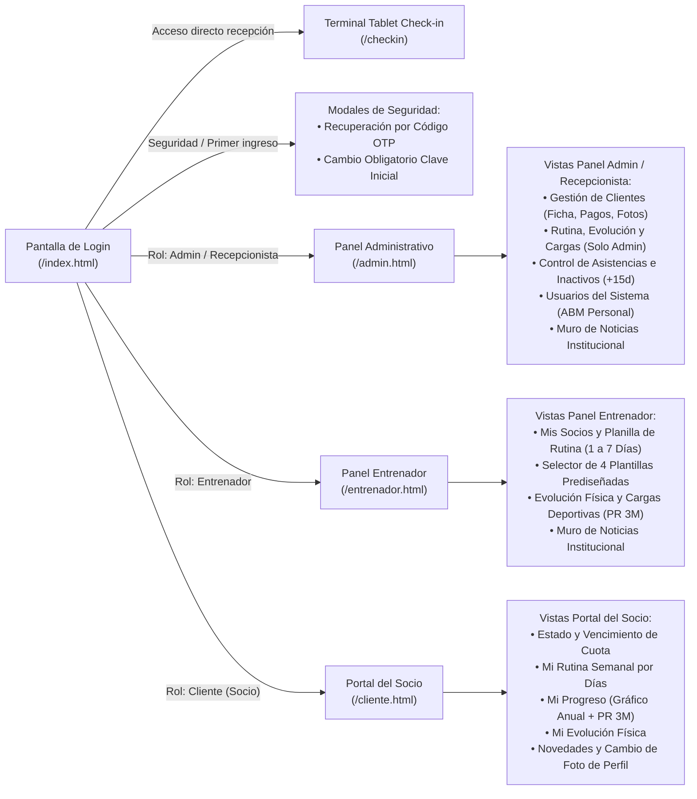

---

# 9. Prototipos e Interfaces de Usuario

El frontend está construido como una **Single Page Application (SPA) multipanel** en HTML5, CSS3 moderno (paleta oscura de alto contraste con acentos verdes/ámbar/rojos y estética *Glassmorphism*) y módulos JavaScript ES6:

1. **Pantalla de Acceso ([index.html](file:///home/agustin/Practicas%20profesionalizantes%20III/2_%20Zarate,%20Bugnoni%20Agustin-20260824T221128Z-1-001/Soma/backend/app/static/index.html)):** Formulario de autenticación por usuario/DNI, flujo modal de recuperación por código OTP y acceso directo a la terminal de Tablet.
2. **Panel de Administración y Recepción ([admin.html](file:///home/agustin/Practicas%20profesionalizantes%20III/2_%20Zarate,%20Bugnoni%20Agustin-20260824T221128Z-1-001/Soma/backend/app/static/admin.html)):**
   - Buscador instantáneo de socios, filtro de activos/inactivos, indicadores tipo semáforo de cuota y apto médico, y bandeja de moderación de fotos de perfil pendientes.
   - Modal de detalle del socio con adaptación dinámica según rol (ocultando automáticamente las pestañas deportivas cuando ingresa un usuario con rol `Recepcionista`).
   - Tablero de **Asistencias** con KPIs diarios/semanales/mensuales, listado de ingresos de hoy y tabla de **Alertas de Inactividad (+15 días)** con botón directo a WhatsApp.
3. **Panel de Entrenador ([entrenador.html](file:///home/agustin/Practicas%20profesionalizantes%20III/2_%20Zarate,%20Bugnoni%20Agustin-20260824T221128Z-1-001/Soma/backend/app/static/entrenador.html)):**
   - Editor de rutina en formato planilla de hasta 7 días con selector de las 4 plantillas prediseñadas.
   - Pestaña de **Evolución Física** y pestaña de **Cargas Deportivas** con gráfico interactivo `Chart.js`, cálculo de **PR de los últimos 3 meses** y paginación por año calendario.
4. **Portal del Socio ([cliente.html](file:///home/agustin/Practicas%20profesionalizantes%20III/2_%20Zarate,%20Bugnoni%20Agustin-20260824T221128Z-1-001/Soma/backend/app/static/cliente.html)):**
   - Cabecera con avatar del socio, estado de cuota y fecha de vencimiento, planilla de rutina por días, pestaña **Mi Progreso** (gráfico anual y PR 3M), **Mi Evolución** y **Muro de Noticias**.
5. **Terminal Táctil de Check-in ([checkin.html](file:///home/agustin/Practicas%20profesionalizantes%20III/2_%20Zarate,%20Bugnoni%20Agustin-20260824T221128Z-1-001/Soma/backend/app/static/checkin.html)):**
   - Teclado numérico táctil de gran tamaño para ingreso autónomo por DNI en recepción con tarjeta de bienvenida y alertas visuales instantáneas.

---

# 10. Diagrama de Clases Global del Sistema

Para garantizar una visualización clara y detallada de la arquitectura en tres capas (**Presentación / Rutas API**, **Lógica de Negocio / Acceso a Datos CRUD** y **Entidades ORM SQLAlchemy**), el diagrama de clases global se estructura en tres vistas complementarias:

## 10.1 Capa de Presentación / Rutas API (Controllers)

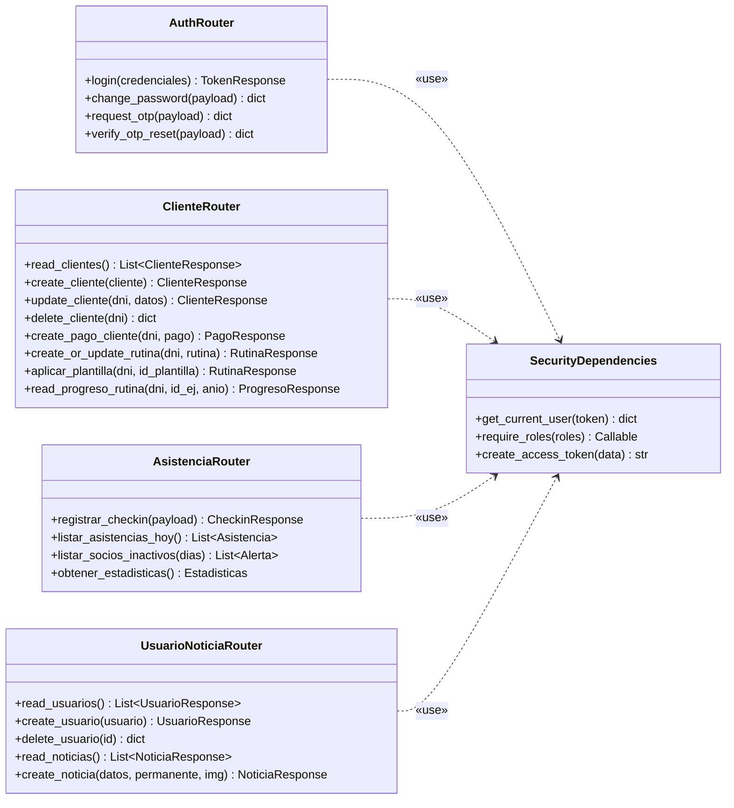

## 10.2 Capa de Negocio y Acceso a Datos (DAL / `crud.py`)

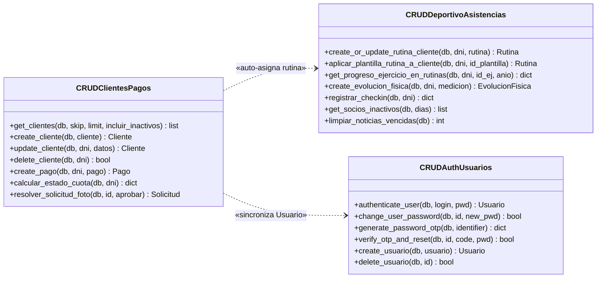

## 10.3 Capa de Entidades de Dominio (Modelos ORM `models.py`)

```mermaid
classDiagram
    direction LR
    class Usuario {
        +int id_usuario PK
        +str nombre
        +str usuario_login UK
        +str password
        +str rol
        +bool debe_cambiar_password
        +bool activo
    }
    class Cliente {
        +str dni PK
        +str nombre
        +str apellido
        +int edad
        +bool activo
        +bool apto_medico_vigente
        +date fecha_vencimiento_apto
        +str foto_url
    }
    class Pago {
        +int id_pago PK
        +str dni_cliente FK
        +date fecha_pago
        +Decimal monto
        +int meses_abonados
        +date fecha_vencimiento_cuota
    }
    class Rutina {
        +int id_rutina PK
        +str dni_cliente FK
        +date fecha_inicio
        +str objetivo
        +bool activa
    }
    class DetalleRutina {
        +int id_detalle PK
        +int id_rutina FK
        +int id_ejercicio FK
        +int dia
        +str nombre_dia
        +int series
        +int repeticiones
        +Decimal carga
    }
    class Asistencia {
        +int id_asistencia PK
        +str dni_cliente FK
        +datetime fecha_hora
        +str estado_cuota
        +bool apto_medico_vigente
    }

    Cliente "1" --> "0..*" Pago : abona
    Cliente "1" --> "0..*" Rutina : posee
    Rutina "1" --> "1..*" DetalleRutina : contiene
    Cliente "1" --> "0..*" Asistencia : registra
    Usuario "1" ..> "0..1" Cliente : login por DNI
```

---

# 11. Diagrama de Componentes

```mermaid
flowchart TB
    subgraph Frontend_SPA["Capa 1: Cliente Web (SPA HTML5 + JS Modular ES6)"]
        direction LR
        UI_MOD["Módulos de Interfaz UI<br/>(clientes, rutinas, evolucion,<br/>asistencias, usuarios, noticias)"]
        API_SVC["Servicios HTTP Fetch<br/>(api.js + *.service.js)"]
        UI_MOD --> API_SVC
    end

    subgraph Backend_FastAPI["Capa 2: Servidor de Aplicación (Python FastAPI)"]
        direction LR
        ROUTERS["Rutas API REST<br/>(auth, cliente, usuario,<br/>noticia, asistencias, ejercicio)"]
        SCHEMAS["Validadores Pydantic v2<br/>(schemas.py)"]
        CRUD_MOD["Negocio y Acceso a Datos<br/>(crud.py)"]
        ORM_MOD["Modelos ORM SQLAlchemy<br/>(models.py)"]
        ROUTERS --> SCHEMAS
        ROUTERS --> CRUD_MOD --> ORM_MOD
    end

    subgraph Storage["Capa 3: Persistencia y Almacenamiento"]
        direction LR
        MYSQL[("Base de Datos Relacional<br/>MySQL 8.0 (GimnasioDB)")]
        FS[("Almacenamiento de Imágenes<br/>(/uploads/perfiles y /noticias)")]
    end

    API_SVC -->|"HTTP JSON + Bearer JWT"| ROUTERS
    ORM_MOD -->|"Pool PyMySQL"| MYSQL
    ROUTERS -->|"Lectura / Escritura"| FS
```

---

# 12. DER Global del Sistema

El esquema relacional consolidado de `GimnasioDB` (19 tablas definidas en [Creacion_de_BD_v1.1.sql](file:///home/agustin/Practicas%20profesionalizantes%20III/2_%20Zarate,%20Bugnoni%20Agustin-20260824T221128Z-1-001/Soma/Documentos/Creacion_de_BD_v1.1.sql)) se divide a continuación en cuatro subsistemas lógicos para garantizar su máxima legibilidad:

## 12.1 DER – Subsistema de Socios, Membresías y Pagos

```mermaid
erDiagram
    Cliente }o--|| Direccion : "se ubica en"
    Cliente ||--o{ Cliente_Membresia : "suscribe"
    Membresia ||--o{ Cliente_Membresia : "define"
    Cliente ||--o{ Pago : "abona"

    Direccion {
        int id_direccion PK
        varchar calle
        varchar numero
        varchar ciudad
    }
    Cliente {
        varchar dni PK
        varchar nombre
        varchar apellido
        int edad
        int id_direccion FK
        varchar email
        varchar telefono
        date fecha_alta
        boolean activo
        boolean apto_medico_vigente
        date fecha_vencimiento_apto
        varchar foto_url
    }
    Membresia {
        int id_membresia PK
        varchar tipo
        decimal precio
        int duracion_dias
    }
    Cliente_Membresia {
        int id_cliente_membresia PK
        varchar dni_cliente FK
        int id_membresia FK
        date fecha_inicio
        date fecha_fin
        varchar estado
    }
    Pago {
        int id_pago PK
        varchar dni_cliente FK
        date fecha_pago
        decimal monto
        varchar metodo_pago
        varchar descripcion
        int meses_abonados
        date fecha_vencimiento_cuota
    }
```

## 12.2 DER – Subsistema de Asistencias, Usuarios, Moderación y Noticias

```mermaid
erDiagram
    Cliente ||--o{ Asistencia : "ingresa"
    Cliente ||--o{ Solicitud_Foto_Perfil : "solicita"
    Usuario ||--o{ Solicitud_Foto_Perfil : "modera"
    Usuario ||--o{ Noticia : "publica"

    Cliente {
        varchar dni PK
        varchar nombre
        varchar apellido
        boolean activo
        varchar foto_url
    }
    Usuario {
        int id_usuario PK
        varchar nombre
        varchar usuario_login UK
        varchar password
        boolean debe_cambiar_password
        varchar rol
        boolean activo
    }
    Asistencia {
        int id_asistencia PK
        varchar dni_cliente FK
        datetime fecha_hora
        varchar estado_cuota
        boolean apto_medico_vigente
    }
    Solicitud_Foto_Perfil {
        int id_solicitud PK
        varchar dni_cliente FK
        varchar foto_propuesta_url
        datetime fecha_solicitud
        varchar estado
        varchar motivo_rechazo
        int id_usuario_revisor FK
        datetime fecha_resolucion
    }
    Noticia {
        int id_noticia PK
        varchar titulo
        text contenido
        varchar categoria
        varchar imagen_url
        boolean permanente
        date fecha_publicacion
        int id_usuario_autor FK
    }
```

## 12.3 DER – Subsistema de Rutinas, Plantillas y Catálogo de Ejercicios

```mermaid
erDiagram
    Cliente ||--o{ Rutina : "posee"
    Rutina ||--|{ Detalle_Rutina : "contiene"
    Usuario ||--o{ Detalle_Rutina : "asigna"
    Ejercicio ||--o{ Detalle_Rutina : "incluye"
    Plantilla_Rutina ||--|{ Detalle_Plantilla_Rutina : "estructura"
    Ejercicio ||--o{ Detalle_Plantilla_Rutina : "referencia"

    Cliente {
        varchar dni PK
        varchar nombre
        varchar apellido
    }
    Usuario {
        int id_usuario PK
        varchar nombre
        varchar rol
    }
    Rutina {
        int id_rutina PK
        varchar dni_cliente FK
        date fecha_inicio
        int periodo
        varchar objetivo
        boolean activa
        text observaciones
    }
    Detalle_Rutina {
        int id_detalle PK
        int id_rutina FK
        int id_usuario FK
        int id_ejercicio FK
        int dia
        varchar nombre_dia
        int series
        int repeticiones
        decimal carga
        varchar descanso
    }
    Ejercicio {
        int id_ejercicio PK
        varchar nombre_ejercicio
        varchar grupo_muscular
        boolean activo
    }
    Plantilla_Rutina {
        int id_plantilla PK
        varchar nombre
        varchar objetivo
        varchar nivel
        int dias_semana
        int duracion_estimada_min
        boolean activo
    }
    Detalle_Plantilla_Rutina {
        int id_detalle_plantilla PK
        int id_plantilla FK
        int id_ejercicio FK
        int dia
        varchar nombre_dia
        int series
        int repeticiones
        decimal carga_sugerida
        varchar descanso
    }
```

## 12.4 DER – Subsistema de Evolución Física y Módulos Proyectados (Turnos y Clases)

```mermaid
erDiagram
    Cliente ||--o{ Evolucion_Fisica : "registra"
    Cliente ||--o{ Registro_Entrenamiento : "entrena"
    Cliente ||--o{ Turno_Nutricional : "reserva"
    Usuario ||--o{ Turno_Nutricional : "atiende"
    Usuario ||--o{ Clase : "dicta"
    Clase ||--o{ Horario_Clase : "programa"
    Horario_Clase ||--o{ Inscripcion_Clase : "aloja"

    Cliente {
        varchar dni PK
        varchar nombre
        varchar apellido
    }
    Usuario {
        int id_usuario PK
        varchar nombre
        varchar rol
    }
    Evolucion_Fisica {
        int id_medicion PK
        varchar dni_cliente FK
        date fecha_medicion
        decimal peso_kg
        decimal porcentaje_grasa
        text observaciones
    }
    Registro_Entrenamiento {
        int id_registro PK
        varchar dni_cliente FK
        int id_ejercicio FK
        date fecha_entrenamiento
        decimal carga_real
        int repeticiones_logradas
    }
    Turno_Nutricional {
        int id_turno PK
        varchar dni_cliente FK
        int id_usuario_nutricionista FK
        date fecha_turno
        time hora_turno
        varchar estado
    }
    Clase {
        int id_clase PK
        varchar nombre_clase
        int id_usuario_profesor FK
        int cupo_maximo
        boolean activo
    }
    Horario_Clase {
        int id_horario PK
        int id_clase FK
        varchar dia_semana
        time hora_inicio
        time hora_fin
    }
    Inscripcion_Clase {
        int id_inscripcion PK
        varchar dni_cliente FK
        int id_horario FK
        date fecha
        boolean asistio
    }
```

---

# 13. Diagrama de Despliegue

```mermaid
flowchart LR
    subgraph Terminales["Nodos Clientes (Navegadores Web)"]
        PC_REC["PC Recepción / Admin<br/>(/admin.html)"]
        TAB_IN["Tablet Mostrador Entrada<br/>(/checkin)"]
        PC_ENT["Terminal Salón Musculación<br/>(/entrenador.html)"]
        MOV_SOC["Móviles Socios<br/>(/cliente.html)"]
    end

    subgraph Host_Server["Servidor de Aplicación y Datos"]
        UVICORN["Servidor ASGI<br/>Uvicorn + FastAPI<br/>(Puerto TCP 8000)"]
        MYSQL_SRV[("MySQL 8.0+<br/>GimnasioDB<br/>(Puerto TCP 3306)")]
    end

    PC_REC <-->|"HTTP / JSON"| UVICORN
    TAB_IN <-->|"HTTP / JSON"| UVICORN
    PC_ENT <-->|"HTTP / JSON"| UVICORN
    MOV_SOC <-->|"HTTP / JSON"| UVICORN
    UVICORN <-->|"TCP 3306 (PyMySQL)"| MYSQL_SRV
```

---

# 14. Especificación de Casos de Prueba

El sistema cuenta con una suite automatizada de **35 pruebas de integración y regresión** ejecutables mediante el comando `make test` (`pytest`), organizadas en 4 módulos de verificación bajo `backend/tests/`:

| Archivo de Prueba | Cantidad de Tests | Casos Validados | Resultado |
| :--- | :---: | :--- | :---: |
| [test_integration_backlog.py](file:///home/agustin/Practicas%20profesionalizantes%20III/2_%20Zarate,%20Bugnoni%20Agustin-20260824T221128Z-1-001/Soma/backend/tests/test_integration_backlog.py) | **16** | Login JWT, Recuperación por Token y OTP (`SOMA-01`), Vista y Editor de Rutina en Planilla Multi-día (`SOMA-02`, `SOMA-03`), Gestión de Usuarios y Permisos Recepcionista/Admin (`SOMA-04`), Muro de Noticias con Imagen, Vencimiento a 60 días y Noticias Permanentes (`SOMA-05`), Borrado Lógico y Re-alta por DNI (`SOMA-06`), Pagos Multimes Acumulativos y Estado de Cuota (`SOMA-07`, `SOMA-08`), Moderación de Foto de Perfil (`SOMA-09`) y Validación estricta de DNI. | **16 / 16 PASS** |
| [test_asistencias.py](file:///home/agustin/Practicas%20profesionalizantes%20III/2_%20Zarate,%20Bugnoni%20Agustin-20260824T221128Z-1-001/Soma/backend/tests/test_asistencias.py) | **7** | Check-in de socio al día, alertas por cuota vencida y apto médico vencido, rechazo de socio inactivo o DNI inválido, listado de asistencias de hoy, detección de socios inactivos (+15 días) y KPIs estadísticos. | **7 / 7 PASS** |
| [test_plantillas_rutina.py](file:///home/agustin/Practicas%20profesionalizantes%20III/2_%20Zarate,%20Bugnoni%20Agustin-20260824T221128Z-1-001/Soma/backend/tests/test_plantillas_rutina.py) | **6** | Listado de las 4 plantillas base, validación de estructura de la plantilla de Iniciación (3 días, <= 50 min), aplicación de plantilla a un socio y auto-asignación de rutina de iniciación en el alta y lectura. | **6 / 6 PASS** |
| [test_progreso_rutinas.py](file:///home/agustin/Practicas%20profesionalizantes%20III/2_%20Zarate,%20Bugnoni%20Agustin-20260824T221128Z-1-001/Soma/backend/tests/test_progreso_rutinas.py) | **6** | Listado de ejercicios en historial de rutinas, progresión mensual de cargas, preservación de cierre mensual al cambiar de mes, control de acceso por socio, cálculo de PR en ventana móvil de los últimos 3 meses (con subida y descarga) y paginación por año calendario (`2025` / `2026`). | **6 / 6 PASS** |
| **TOTAL SUITE** | **35** | **Cobertura integral de requerimientos funcionales y reglas de negocio** | **35 / 35 PASS** |
