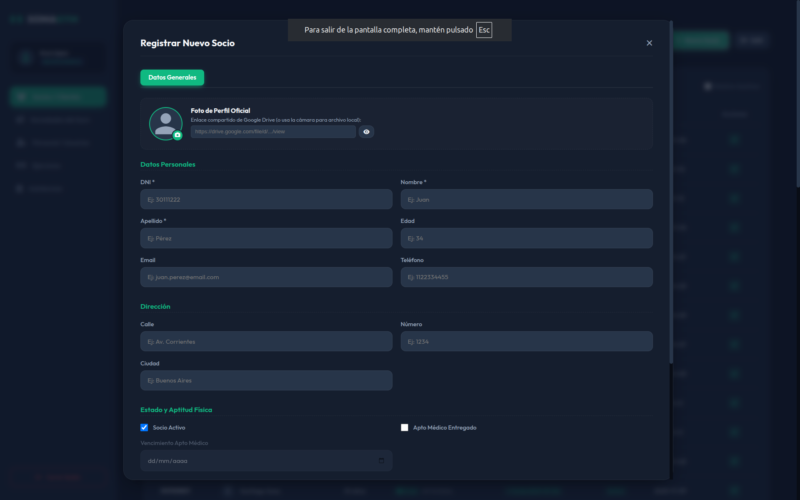
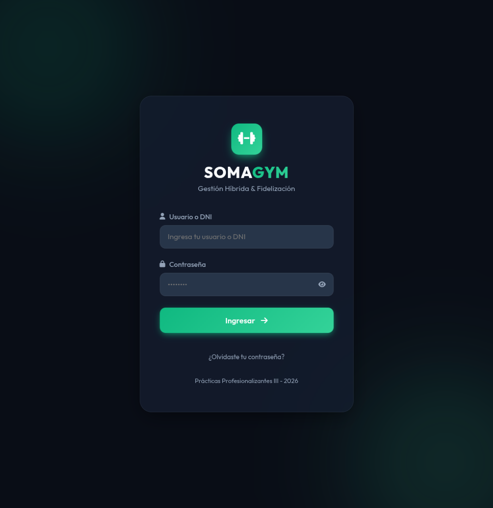
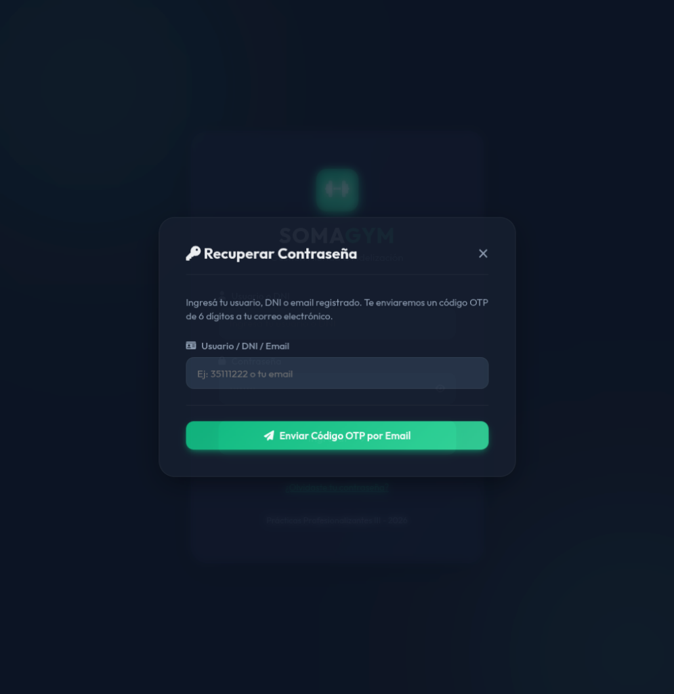
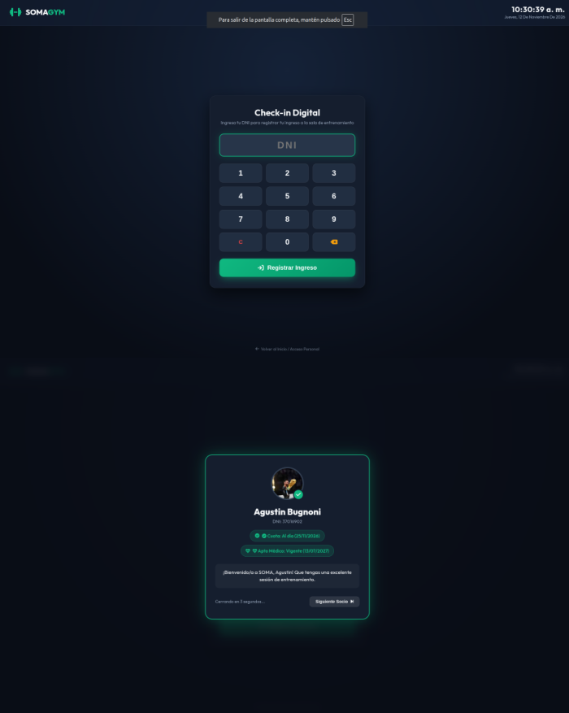
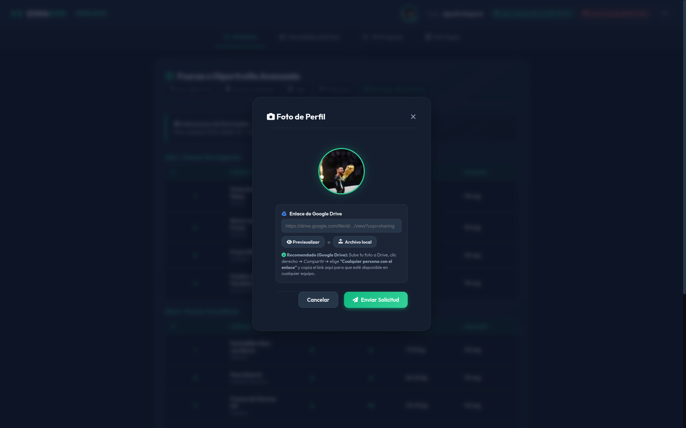
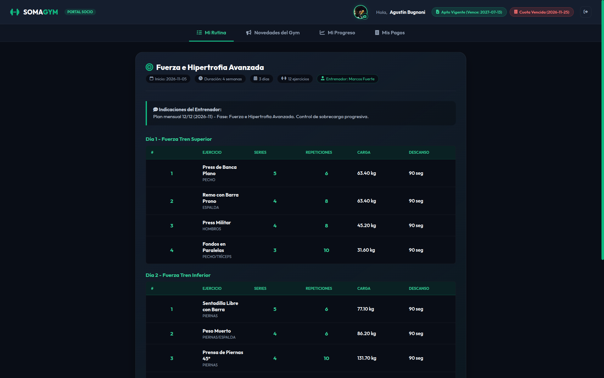
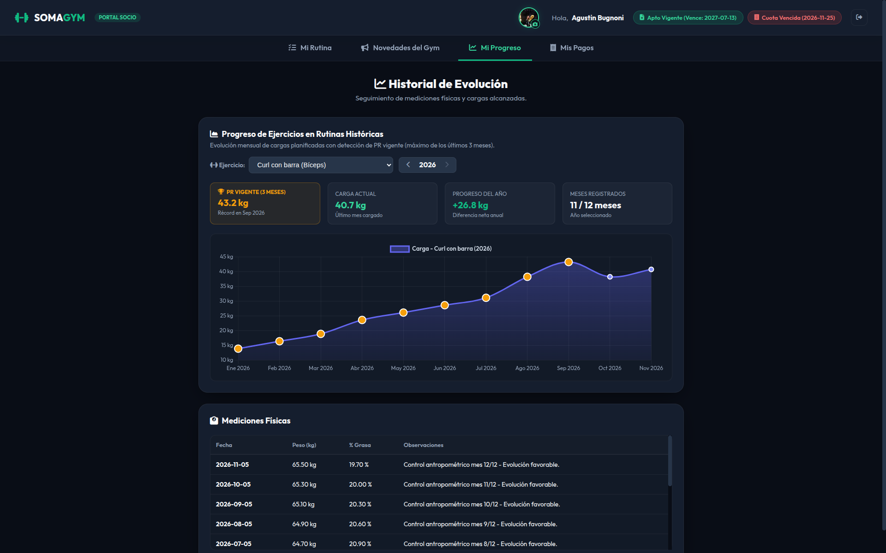
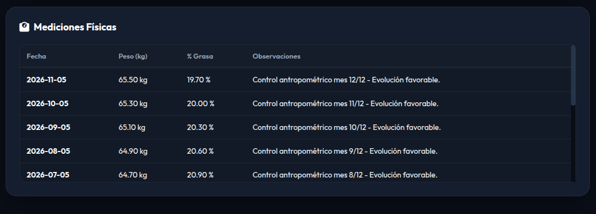
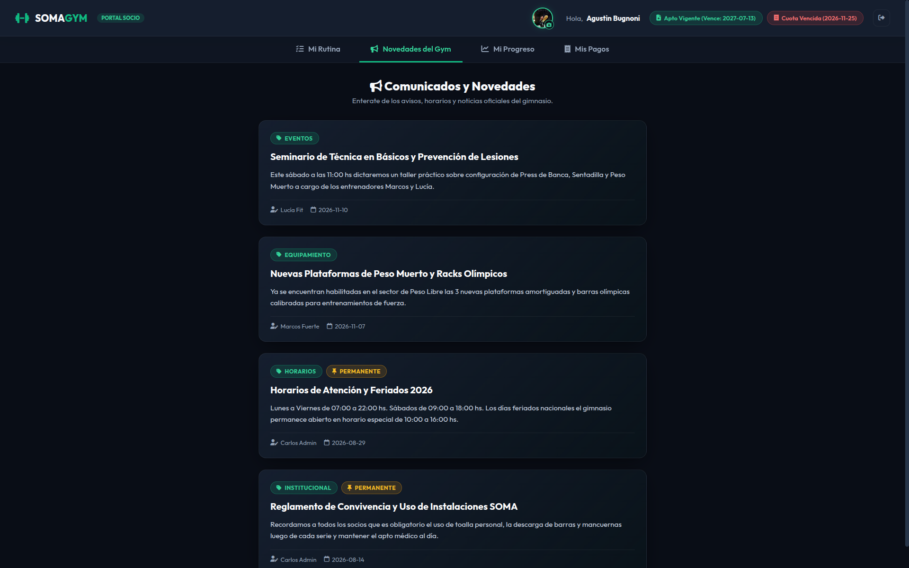
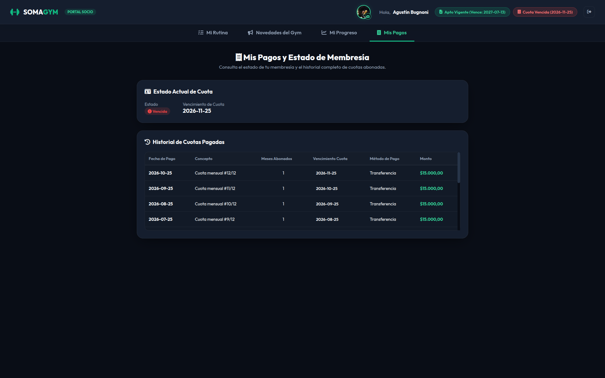

# Manual de Usuario – Sistema SOMA (Gestión Integral de Gimnasios)

**Carrera:** Tecnicatura Superior en Desarrollo de Software  
**Materia:** Prácticas Profesionalizantes III  
**Profesores:** Gustavo Gómez; Silvia Rocchi  
**Integrantes:** Bugnoni Agustín; Zárate Lorenzo  
**Versión:** 1.2 (Consolidada)  
**Perfil de Referencia:** Socio / Cliente (`DNI 37016902` – Agustín Bugnoni) y Recepción  

---

## Tabla de Contenidos

1. [Introducción y Alcance del Manual](#1-introducción-y-alcance-del-manual)
2. [Alta Inicial del Socio en Recepción (Rol Recepcionista)](#2-alta-inicial-del-socio-en-recepción-rol-recepcionista)
   - [2.1 Registro de Datos Personales y Aptitud Física](#21-registro-de-datos-personales-y-aptitud-física)
   - [2.2 Generación Automática de Credenciales del Socio](#22-generación-automática-de-credenciales-del-socio)
3. [Acceso al Sistema y Seguridad de la Cuenta](#3-acceso-al-sistema-y-seguridad-de-la-cuenta)
   - [3.1 Inicio de Sesión (Login)](#31-inicio-de-sesión-login)
   - [3.2 Cambio Obligatorio de Contraseña en el Primer Ingreso](#32-cambio-obligatorio-de-contraseña-en-el-primer-ingreso)
   - [3.3 Recuperación de Contraseña mediante Código OTP](#33-recuperación-de-contraseña-mediante-código-otp)
4. [Registro de Asistencia en Terminal de Entrada (`/checkin`)](#4-registro-de-asistencia-en-terminal-de-entrada-checkin)
5. [Portal de Autogestión del Socio (`/cliente.html`)](#5-portal-de-autogestión-del-socio-clientehtml)
   - [5.1 Cabecera Principal y Estado de Cuota](#51-cabecera-principal-y-estado-de-cuota)
   - [5.2 Actualización y Aprobación de Foto de Perfil](#52-actualización-y-aprobación-de-foto-de-perfil)
   - [5.3 Pestaña «Mi Rutina» (Planilla Semanal por Días)](#53-pestaña-mi-rutina-planilla-semanal-por-días)
   - [5.4 Pestaña «Mi Progreso» (Evolución de Cargas y Récord Personal PR 3M)](#54-pestaña-mi-progreso-evolución-de-cargas-y-récord-personal-pr-3m)
   - [5.5 Sección «Mediciones Físicas» (Peso Corporal y % de Grasa)](#55-sección-mediciones-físicas-peso-corporal-y--de-grasa)
   - [5.6 Pestaña «Novedades del Gym» (Comunicados y Avisos Permanentes)](#56-pestaña-novedades-del-gym-comunicados-y-avisos-permanentes)
   - [5.7 Pestaña «Mis Pagos» (Estado de Membresía e Historial de Cuotas)](#57-pestaña-mis-pagos-estado-de-membresía-e-historial-de-cuotas)
6. [Preguntas Frecuentes para el Socio](#6-preguntas-frecuentes-para-el-socio)

---

## 1. Introducción y Alcance del Manual

El presente **Manual de Usuario** describe de forma guiada y visual el uso del sistema web **SOMA GYM**, centrándose principalmente en la experiencia del **Socio (Cliente)** a través de la terminal de ingreso al gimnasio (**Check-in Digital**) y del **Portal de Autogestión del Socio**.

Asimismo, en la **Sección 2** se detalla brevemente cómo el personal de **Recepción** realiza el alta inicial del socio en el sistema, dado que dicho procedimiento origina la cuenta de usuario con la cual el cliente ingresa a la plataforma. Para ejemplificar las pantallas reales del sistema se utilizan los datos del socio **Agustín Bugnoni (`DNI 37016902`)**.

---

## 2. Alta Inicial del Socio en Recepción (Rol Recepcionista)

El socio no se registra de forma anónima desde Internet; su inscripción se realiza presencialmente en el mostrador del gimnasio por un usuario con rol **Recepcionista** (por ejemplo, `alopez`) o **Administrador** (`cadmin`).

### 2.1 Registro de Datos Personales y Aptitud Física

1. El recepcionista inicia sesión en el panel administrativo y accede en el menú lateral a la sección **Socios y Clientes**.
2. Presiona el botón **«+ Nuevo Socio»** para desplegar la ventana modal **«Registrar Nuevo Socio»**.
3. Completa el formulario de inscripción con los datos del cliente:
   - **Foto de Perfil Oficial (Opcional):** Permite ingresar un enlace compartido de Google Drive (con botón de previsualización) o seleccionar un archivo local desde el equipo.
   - **Datos Personales:**
     - **DNI \* (7 u 8 dígitos numéricos):** Por ejemplo, `37016902`. El sistema valida en tiempo real que no contenga letras, puntos ni espacios y que no exista otro socio activo con el mismo documento.
     - **Nombre \* y Apellido \*:** Datos identificatorios del socio.
     - **Edad, Email y Teléfono:** El correo electrónico es indispensable para que el socio pueda recuperar su contraseña por código OTP en caso de olvido.
   - **Dirección:** Calle, número y ciudad de residencia.
   - **Estado y Aptitud Física:** Casillas de verificación de **«Socio Activo»** y **«Apto Médico Entregado»**, junto con la fecha de **Vencimiento del Apto Médico**.
4. Finalmente, se asocia su plan de membresía y su pago inicial (especificando la cantidad de meses abonados y el método de pago: *Efectivo*, *Transferencia*, *Tarjeta de Débito* o *Tarjeta de Crédito*).

### 2.2 Generación Automática de Credenciales del Socio

En el instante en que Recepción confirma el alta del cliente:
- El sistema crea automáticamente la cuenta de acceso del socio con el rol **Cliente**.
- **Usuario de acceso (`usuario_login`):** Es el número de **DNI** del socio (ej. `37016902`).
- **Contraseña temporal inicial:** Por defecto es **`clave1234`**, quedando marcada la cuenta (`debe_cambiar_password = True`) para solicitar obligatoriamente el cambio de clave en su primer inicio de sesión.

---

## 3. Acceso al Sistema y Seguridad de la Cuenta

### 3.1 Inicio de Sesión (Login)

Para ingresar a su portal personal desde cualquier teléfono móvil, tablet o computadora:

1. Abrir el navegador web y dirigirse a la pantalla principal de acceso de **SOMA GYM**.
2. En el campo **Usuario o DNI**, ingresar su número de documento sin puntos ni espacios: `37016902`.
3. En el campo **Contraseña**, ingresar su clave personal (o la contraseña temporal **`clave1234`** si es la primera vez que ingresa al sistema).
4. Hacer clic en el botón **«Ingresar»**. El sistema identificará automáticamente el rol **Cliente** y redirigirá al socio hacia el **Portal Socio (`/cliente.html`)**.

### 3.2 Cambio Obligatorio de Contraseña en el Primer Ingreso

Por razones de privacidad y seguridad, cuando el socio ingresa por primera vez utilizando la contraseña inicial por defecto (**`clave1234`**), el sistema despliega de inmediato una ventana obligatoria de **Actualización de Contraseña**:

1. Ingresar una nueva contraseña personal de al menos **6 caracteres** (distinta de `clave1234`).
2. Repetir la contraseña en el campo de confirmación.
3. Presionar **«Actualizar Contraseña»** para desbloquear el acceso completo al portal.

### 3.3 Recuperación de Contraseña mediante Código OTP

Si el socio olvida su contraseña, puede restablecerla sin necesidad de acudir a recepción siguiendo estos pasos:

1. En la pantalla de inicio de sesión, hacer clic sobre el enlace **«¿Olvidaste tu contraseña?»**.
2. Se abrirá el asistente **Recuperar Contraseña**: ingresar el **DNI** (`37016902`), usuario o **correo electrónico** registrado en el gimnasio y presionar **«Enviar Código»**.
3. El sistema enviará a su casilla de correo electrónico un **código numérico de 6 dígitos (OTP)** con una validez de **15 minutos**.
4. Ingresar el código recibido de 6 dígitos junto con la nueva contraseña deseada y confirmar la operación.

---

## 4. Registro de Asistencia en Terminal de Entrada (`/checkin`)

Al llegar a las instalaciones del gimnasio, el socio debe registrar su presente en la terminal táctil (**Check-in Digital** ubicada en la entrada de la sala de entrenamiento):

1. En la pantalla **Check-in Digital**, ingresar el número de **DNI** (`37016902`) utilizando el teclado numérico en pantalla (o el teclado físico) y presionar el botón verde **«Registrar Ingreso»**.
2. El sistema valida la ficha del socio al instante y despliega una **Tarjeta de Bienvenida** con la siguiente información:
   - **Fotografía de perfil, Nombre Completo y DNI:** *Agustin Bugnoni – DNI: 37016902*.
   - **Estado de la Cuota:** Etiqueta semafórica indicando **«Cuota: Al día»** (verde), **«Por vencer»** (amarillo) o **«Vencida»** (rojo), junto con la fecha exacta de vencimiento (ej. `25/11/2026`).
   - **Estado del Apto Médico:** Confirmación de vigencia y fecha de vencimiento del certificado médico (ej. `Apto Médico: Vigente (13/07/2027)`).

---

## 5. Portal de Autogestión del Socio (`/cliente.html`)

Una vez que el socio inicia sesión con su cuenta (`37016902`), accede al **Portal Socio**, organizado en una cabecera informativa y cuatro pestañas de navegación: **Mi Rutina**, **Novedades del Gym**, **Mi Progreso** y **Mis Pagos**.

### 5.1 Cabecera Principal y Estado de Cuota

En la barra superior del portal del socio se visualizan de forma permanente:
- **Identificación y Avatar:** Saludo personalizado (*Hola, Agustin Bugnoni*) junto a su fotografía de perfil con acceso directo al botón de cámara para actualizarla.
- **Indicador de Apto Médico:** Etiqueta que informa si el certificado médico se encuentra vigente y su fecha de expiración (`Apto Vigente (Vence: 2027-07-13)`).
- **Indicador Rápido de Cuota:** Etiqueta semafórica que muestra en todo momento si la cuota está **Al día**, **Por vencer** o **Cuota Vencida** junto con su fecha de vencimiento (`2026-11-25`).
- **Botón de Cerrar Sesión:** Ubicado en el extremo derecho para salir de la cuenta de forma segura.

---

### 5.2 Actualización y Aprobación de Foto de Perfil

El socio puede solicitar el cambio de su fotografía de perfil directamente desde su celular o computadora:

1. Hacer clic sobre el ícono de la **cámara fotográfica** situado sobre su imagen de perfil en la barra superior.
2. Se abrirá la ventana **«Foto de Perfil»**, donde el socio puede elegir entre dos modalidades de carga:
   - **Enlace de Google Drive (Recomendado):** Pegar el enlace público de una imagen subida a Google Drive y presionar **«Previsualizar»**.
   - **Archivo local:** Presionar el botón **«Archivo local»** para subir una foto desde la galería del teléfono o la computadora (formatos `JPG`, `PNG` o `WEBP`, hasta 5 MB).
3. Hacer clic en el botón verde **«Enviar Solicitud»**.
4. La imagen quedará en estado **Pendiente de aprobación** hasta que el personal de recepción o entrenamiento la valide desde el panel administrativo, momento en el cual se actualizará automáticamente en el portal y en el Check-in Digital.

---

### 5.3 Pestaña «Mi Rutina» (Planilla Semanal por Días)

La primera pestaña del portal, **«Mi Rutina»**, muestra la planilla de entrenamiento vigente asignada por el profesor del gimnasio:

- **Encabezado del Plan de Entrenamiento:** Indica el título de la rutina actual (ej. *Fuerza e Hipertrofia Avanzada*) acompañado de etiquetas con la **Fecha de inicio** (`2026-11-05`), **Duración** (`4 semanas`), **Frecuencia semanal** (`3 días`), **Total de ejercicios** (`12 ejercicios`) y el **Entrenador a cargo** (*Marcos Fuerte*).
- **Indicaciones del Entrenador:** Recuadro destacado donde el profesor deja observaciones técnicas sobre el mesociclo actual (ej. *Control de sobrecarga progresiva*).
- **Tablas Desglosadas por Día de Entrenamiento:** La rutina se organiza en bloques por jornada (ej. *Día 1 – Fuerza Tren Superior*, *Día 2 – Fuerza Tren Inferior*, *Día 3*). Para cada ejercicio programado se detalla:
  - **# (Orden)** dentro de la sesión.
  - **Ejercicio y Grupo Muscular** (ej. *Press de Banca Plano – PECHO*, *Sentadilla Libre con Barra – PIERNAS*).
  - **Series y Repeticiones** objetivo (ej. `5` series de `6` repeticiones).
  - **Carga planificada** en kilogramos (ej. `63.40 kg`, `77.10 kg`).
  - **Descanso** indicado entre series (ej. `90 seg`).

---

### 5.4 Pestaña «Mi Progreso» (Evolución de Cargas y Récord Personal PR 3M)

Al acceder a la pestaña **«Mi Progreso»** (*Historial de Evolución*), el socio puede analizar gráficamente la evolución de sus cargas a lo largo de todas sus rutinas históricas:

1. **Selector de Ejercicio y Año Calendario:** En el bloque **«Progreso de Ejercicios en Rutinas Históricas»**, el socio selecciona cualquier ejercicio de su plan (por ejemplo, *Curl con barra (Bíceps)*) y el año que desea consultar (`< 2026 >`).
2. **Tarjetas de Indicadores Clave (KPIs Deportivos):**
   - **PR VIGENTE (3 MESES):** Destaca en color dorado el **Récord Personal (peso máximo alcanzado en los últimos 3 meses)** junto con el mes en que se logró (ej. `43.2 kg – Récord en Sep 2026`).
   - **CARGA ACTUAL:** Muestra el peso asignado en el último mes cargado (ej. `40.7 kg`).
   - **PROGRESO DEL AÑO:** Calcula automáticamente la diferencia neta anual de fuerza ganada en ese ejercicio (ej. `+26.8 kg`).
   - **MESES REGISTRADOS:** Cantidad de meses con registros sobre el año seleccionado (ej. `11 / 12 meses`).
3. **Gráfico Lineal Interactivo:** Representa mes a mes (`Ene 2026` a `Nov 2026`) la curva de evolución de la carga en kilogramos para el ejercicio seleccionado.

---

### 5.5 Sección «Mediciones Físicas» (Peso Corporal y % de Grasa)

En la parte inferior de la pestaña **«Mi Progreso»** se ubica la tabla **«Mediciones Físicas»**, donde el socio consulta todos los controles antropométricos registrados junto a su entrenador:

- **Fecha del Control:** Ordenada desde la medición más reciente hacia las anteriores (ej. `2026-11-05`, `2026-10-05`, etc.).
- **Peso (kg):** Registro exacto del peso corporal en kilogramos (ej. `65.50 kg`).
- **% Grasa:** Porcentaje de grasa corporal medido en cada evaluación (ej. `19.70 %`), permitiendo verificar la evolución mes a mes.
- **Observaciones:** Comentarios profesionales del entrenador sobre el control mensual (ej. *Control antropométrico mes 12/12 – Evolución favorable*).

---

### 5.6 Pestaña «Novedades del Gym» (Comunicados y Avisos Permanentes)

Al seleccionar la pestaña **«Novedades del Gym»** (*Comunicados y Novedades*), el socio accede al muro informativo oficial del gimnasio:

- **Etiquetas por Categoría:** Cada comunicado identifica su temática mediante una etiqueta de color (por ejemplo, `EVENTOS`, `EQUIPAMIENTO`, `HORARIOS`, `INSTITUCIONAL`).
- **Avisos Fijados (`PERMANENTE`):** Los comunicados esenciales del gimnasio (como *Horarios de Atención y Feriados 2026* o el *Reglamento de Convivencia y Uso de Instalaciones SOMA*) poseen la insignia dorada **`PERMANENTE`** y permanecen visibles sin expirar.
- **Autor y Fecha de Publicación:** Al pie de cada tarjeta se informa qué miembro del staff publicó la noticia y en qué fecha.

---

### 5.7 Pestaña «Mis Pagos» (Estado de Membresía e Historial de Cuotas)

Al hacer clic en la cuarta pestaña, **«Mis Pagos»** (*Mis Pagos y Estado de Membresía*), el socio puede consultar de forma transparente su situación administrativa y todos los pagos que ha realizado en el gimnasio:

1. **Bloque «Estado Actual de Cuota»:**
   - **Estado:** Muestra mediante un indicador visual claro si la membresía se encuentra **Al día** (en color verde), **Por vencer** (en color amarillo cuando restan pocos días de vigencia) o **Vencida** (en color rojo, como se observa en el ejemplo cuando la fecha actual supera la cobertura activa).
   - **Vencimiento de Cuota:** Informa la fecha exacta hasta la cual se extiende la cobertura abonada (ej. `2026-11-25`). Si el socio abona varios meses por adelantado en recepción, esta fecha acumula automáticamente todos los períodos pagados.
2. **Tabla «Historial de Cuotas Pagadas»:**
   - Lista cronológicamente todos los pagos efectuados por el socio desde su inscripción, detallando en cada fila:
     - **Fecha de Pago:** Día en que se registró el cobro en recepción (ej. `2026-10-25`, `2026-09-25`).
     - **Concepto:** Descripción del abono (ej. *Cuota mensual #12/12*, *Cuota mensual #11/12*).
     - **Meses Abonados:** Cantidad de meses incluidos en esa transacción (`1`, `3`, etc.).
     - **Vencimiento Cuota:** Fecha de vencimiento resultante tras aplicar ese pago.
     - **Método de Pago:** Medio utilizado (*Transferencia*, *Efectivo*, *Tarjeta de Débito*, *Tarjeta de Crédito*).
     - **Monto:** Importe abonado en pesos (ej. `$15.000,00`).

---

## 6. Preguntas Frecuentes para el Socio

| Consulta Frecuente | Solución Paso a Paso |
| :--- | :--- |
| **¿Cuál es mi usuario y contraseña la primera vez que entro?** | Tu usuario es tu número de **DNI** sin puntos (ej. `37016902`) y tu contraseña temporal por defecto es **`clave1234`**. Al ingresar por primera vez, el sistema te pedirá obligatoriamente elegir una contraseña personal nueva. |
| **Olvidé mi contraseña y no tengo acceso a mi correo electrónico.** | Podés acercarte al mostrador de **Recepción** para actualizar tu correo electrónico y recuperar el acceso, o solicitar al administrador que restablezca tu clave temporal. |
| **Pagué dos o más meses juntos por adelantado, ¿dónde veo mi vencimiento y mis comprobantes?** | En la pestaña **«Mis Pagos»** (y en la barra superior del portal). El sistema acumula automáticamente los meses abonados sobre tu fecha de vencimiento vigente y registra el detalle en la tabla **Historial de Cuotas Pagadas**. |
| **Subí una nueva foto de perfil pero sigo viendo la anterior.** | Por políticas del gimnasio, toda nueva fotografía queda en estado *Pendiente de revisión* hasta que un recepcionista o entrenador la apruebe en el panel de control. |
| **Cambiaron mi rutina este mes, ¿se pierden mis pesos de los meses anteriores?** | No. Todas las rutinas anteriores quedan almacenadas en tu historial deportivo y sus pesos se utilizan automáticamente en la pestaña **«Mi Progreso»** para armar tus gráficos anuales y calcular tu **PR Vigente (3 Meses)**. |
